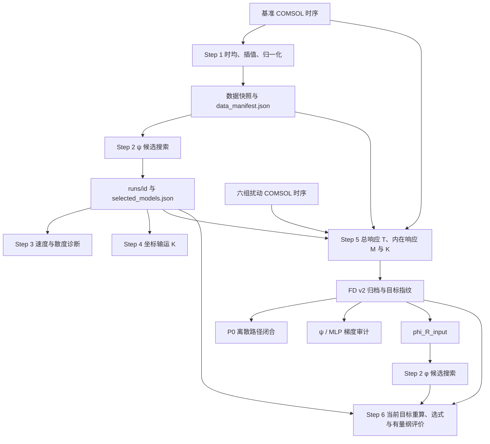

# 数据、模型和评价协议（2026-09-08）

本次修正恢复了主流程的文件接口，统一表达式身份和评价目标，并纠正报告口径。仓库里的既有 CFD 指标和图表仍是历史产物；合成回归测试不能替代真实数据重训。

## 模块与文件关系

P1 是独立的合成字典可辨识性实验；P2 是独立的解析导数损失实验。二者不直接提供 CFD 参数响应真值。`pipeline_contracts.py` 提供各模块共用的数据校验、运行解析、表达式身份和 FD 归档验证。

## 快照与运行

| 文件 | 内容及约束 |
|---|---|
| `wake_data.csv`、`v_mean_wake.npy`、`meta.json` | 完整笛卡尔网格及速度目标；CSV 按 ξ、η 排序后须与 NPY 的 `(n_x_wake,n_y)` 对应；间距、有限值和归一化必须一致。 |
| `data_manifest.json` | 网格形状、范围与坐标指纹，u/v 目标指纹、D/U/圆心参数、数据身份和三个源文件的 SHA256。 |
| `runs/<run_id>/run_manifest.json` | 输入数据身份、搜索设置、本次实际策略及 `running/complete/failed` 状态。 |
| `current_run.json` | 指向根目录内最近一次成功运行；失败不改变指针。 |
| `selected_models.json` | 每个实际策略的表达式、解析 u/v、复杂度、候选索引、选择准则、分数、表达式和候选表指纹，以及训练数据身份。 |

Step 2 ψ（也用于 φ）每次创建空的新运行目录。只运行 B 时，旧根目录的 A 表保持原样，不会被新运行读取。Step 3/4、Step 5/6 和相关审计接受运行根目录或一个已完成的运行目录；运行中的目录和失败目录会被拒绝。

无运行指针的旧平铺目录仍可读取，首次选式会生成标记为 `legacy_unverified` 的选择清单。这只能固定以后使用的身份，不能补证历史训练来源。新 ψ 运行成功后，根目录的旧结果自然隔离；不删除或搬迁原有研究产物。若需要更换数据或候选，应创建新运行，不能编辑已固定的快照继续复用旧评价。

## 选择准则与评价版本

- ψ A：在训练快照上按解析 u MSE 选择；ψ B：按解析 `u_MSE + lambda_v*v_MSE` 选择。并列时依次用复杂度和候选索引。复杂度 21 没有特殊地位。
- Step 3/4 固定使用该选择。`validation_manifest.json`、`transport_manifest.json` 写明训练数据、评价数据和表达式身份；这里的 validation 是训练快照上的诊断，不是独立测试。
- Step 5 分开记录模型训练网格和 CFD 评价网格。允许显式在更密的网格评价旧表达式，但归一化和基准场必须一致，并记录目标版本。`fd_sensitivity_fields.npz` 恢复 `u_Rp/u_Rn/u_cxp/u_cxn/u_cyp/u_cyn` 及 v 对应字段，同时嵌入 `provenance_json`。`fd_manifest.json` 保存网格、基准模型、算例、步长、归一化、时间窗和字段指纹；闭合归档和 φ 输入携带同一 `fd_target_id`。
- Step 6 从 φ 候选表达式重新求导，在当前 FD 的 M_u/M_v 目标上计算误差。旧表误差保存为 `training_mse`、`training_mse_v`，选式按当前目标的 `MSE_u/mean(M_u²) + MSE_v/mean(M_v²)`；分母有零值保护，奇异候选拒绝。选择写入 `response_selection.json`，与 Step 2 的训练选式身份区分。该指标是当前目标重建误差；它不构成独立测试。
- P0 和梯度审计核对 FD 字段指纹、基准模型身份与闭合归档目标，拒绝无来源信息的旧 FD 文件。MLP 速度误差也在同一 FD 目标上重算，记录种子文件指纹。

## 公式及图表含义

ψ 的模型散度是 `∂ξu_pred + ∂ηv_pred`。`∂ξu_pred + ∂ηv_data` 单独作为混合残差，不能称为 ψ 模型违反不可压缩约束。Step 3 分别输出两类图。

Step 4 求的是冻结无量纲表达式的坐标输运项：

\[
K_R=-\frac{2}{D}(\xi\partial_\xi f+\eta\partial_\eta f),\quad
K_{c_x}=-\frac{1}{D}\partial_\xi f,\quad
K_{c_y}=-\frac{1}{D}\partial_\eta f.
\]

总响应为 `T=K+M`。Step 4 的旧 `S_*` 列是 K 的兼容别名；FD NPZ 中历史 `S_R/S_cx/S_cy` 字段却是 M，`S_total_*` 是 T。保留旧键仅为兼容，新报告应使用明确的 K/M/T 标签。冻结表达式的 Taylor 自检不是 CFD 参数验证。中心线 `η=0` 只消去 η 项，ξ 项仍可能非零。

有量纲表达式统一为 `φ_dim = U0 φ + Uprime ψ0`，总响应为 `U0 K[ψ0] + curl(φ_dim)`。Step 6 的导出公式、保存数组和“完全符号化”指标使用同一表达式，不再用 CFD 基准速度替换公式中的 ψ 导数。

## P1/P2 与报告

P1 在每个预算上重新均匀覆盖完整候选行域，协议标记为 `full_domain_uniform_per_budget_v2`；不再截取最大预算点集的前缀。历史均匀采样比较需要重跑。

P2 使用训练随机点、另一随机种子的验证点和密集测试网格。先在验证集固定来源、候选索引和表达式，再评价测试集；测试失败报错，不能换选另一式子。`evaluation_splits.npz` 保存坐标，`metrics.json` 保存三组坐标和目标指纹、选式指标及表达式指纹。全候选测试图和等复杂度比较均为选择后的诊断。历史“梯度 MSE 降低 68.4%”来自复用选式网格的旧协议，独立测试提升尚待重算。

汇总脚本支持 `--p0-dir/--p1-dir/--p2-dir/--out-dir`，在输出中保留源文件指纹和协议状态。报告生成器的历史数字已加说明；已有 Word、图表和结果文件没有重新生成。

## 重跑及测试顺序

1. Step 1 生成当前数据与清单。
2. Step 2 ψ 训练新运行；Step 3/4 读取已固定的模型选择。
3. Step 5 生成 FD v2、闭合归档和 φ 输入，然后执行 P0 与梯度审计。
4. Step 2 φ 训练；Step 6 在当前 FD 目标上重算候选并导出公式和指标。
5. 重跑 P1、P2，最后汇总；使用独立输出目录保存新旧科研结果。

`python -m pytest tests -q` 覆盖运行隔离、失败发布、字段/指纹校验、A-only/B-only/A+B、散度和中心线反例、Step 6 目标重算、有量纲一致性、P1 全域采样、P2 独立选式，以及小型七算例 COMSOL 文件链。合成测试仅替换符号搜索环节，未启动 PySR/Julia，也未验证真实 CFD 重训精度。
