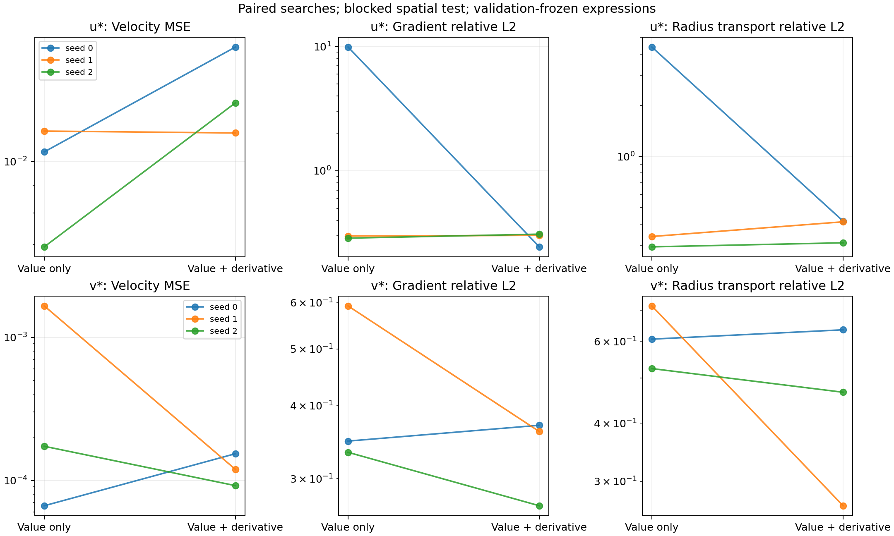

# 真实尾流导数感知符号回归对照

分别拟合 u*、v*；模型的导数由表达式树解析求值，测试时独立用 SymPy 求导。
导数监督是数值 CFD 参考，不是真实连续解的精确导数。

## 固定协议

```json
{
  "seeds": [
    0,
    1,
    2
  ],
  "components": [
    "u",
    "v"
  ],
  "niterations": 30,
  "populations": 8,
  "population_size": 40,
  "maxsize": 25,
  "ncycles_per_iteration": 150,
  "lambdas": [
    0.0,
    1.0
  ],
  "precision": 64,
  "parallelism": "serial",
  "operators": [
    "+",
    "-",
    "*",
    "/",
    "sin",
    "cos"
  ],
  "selection": [
    "normalized_value",
    "h1"
  ],
  "coordinate_shift": [
    4.0,
    0.0
  ]
}
```

训练/验证/测试点数：{'train': 992, 'validation': 186, 'test': 248}。原始列分区：{'train': [(0, 8), (13, 20), (26, 33)], 'validation': [(8, 13)], 'test': [(20, 26)]}（左闭右开）。
各分区端点各去掉一列/行；三点中心差分模板不跨分区，归一化尺度仅来自训练集。
连续测试块检验同一 CFD 算例内的空间插值；不代表跨几何泛化。
损失为 L=MSE(q)/Var_train(q)+λ/2·[MSE(qξ)/mean_train(qξ²)+MSE(qη)/mean_train(qη²)]，λ=0 或 1。
两组算子、复杂度、迭代数、种群和种子相同；解析导数增加每次求值成本，故不等同于相同耗时。
在独立验证块分别按值误差、H1选式并保存，再一次性评价测试块。主对照为 λ=0 按值选式与 λ=1 按 H1 选式。

## 测试结果（种子均值 ± 样本标准差）

|分量|训练|速度 MSE|ξ 导数相对 L2|η 导数相对 L2|合并梯度相对 L2|K_R 相对 L2|
|---|---|---:|---:|---:|---:|---:|
|u|仅值|0.009575 ± 0.00235|95.65 ± 7.54%|350 ± 560%|348.7 ± 553%|168.1 ± 236%|
|u|值+导数|0.0135 ± 0.00259|114.1 ± 18.2%|23.89 ± 4.18%|28.59 ± 3.56%|38.04 ± 6.03%|
|v|仅值|0.0006326 ± 0.00089|81.13 ± 16.5%|35.45 ± 15.1%|42.42 ± 14.6%|61.54 ± 9.57%|
|v|值+导数|0.0001216 ± 3.1e-05|59.16 ± 18.9%|28.2 ± 8.62%|33.35 ± 5.56%|45.59 ± 18.5%|

## 配对变化（负值表示误差下降）

|分量|种子|速度 MSE 变化|梯度相对 L2 变化|K_R 相对 L2 变化|
|---|---:|---:|---:|---:|
|u|0|+57.02%|-97.52%|-90.54%|
|u|1|-0.80%|+1.22%|+22.01%|
|u|2|+85.84%|+7.63%|+5.63%|
|v|0|+131.15%|+6.42%|+4.72%|
|v|1|-92.81%|-39.05%|-62.82%|
|v|2|-46.94%|-18.99%|-11.06%|

`paired_changes.csv` 同时保存相同选式准则的交叉对照，区分搜索与选式的贡献。
`test_metrics.csv` 的 savgol5_stability 是分区内 5 点三阶 Savitzky–Golay 平滑后的导数参考敏感性检查，不参与训练、选式或调参。

K_R=−(ξ qξ+η qη)/R，此处评价坐标输运项相对数值梯度参考的误差；没有用它替代总参数响应 T=K+M。
这是直接速度符号回归，没有施加流函数无散硬约束。只有一份 CFD 快照和三个搜索种子，结果属探索性证据。
未把历史流函数模型与本轮不同训练协议直接作因果比较。



## 复现

```powershell
.\scripts\Invoke-DeeplearningPython.ps1 -ScriptPath .\experiments\wake_derivative_aware_sr.py --out-dir outputs/wake_derivative_aware_sr_2026-09-28_typed
```

数据、代码和协议指纹见 protocol.json；完整公式见各 fit 的 selection.json。
