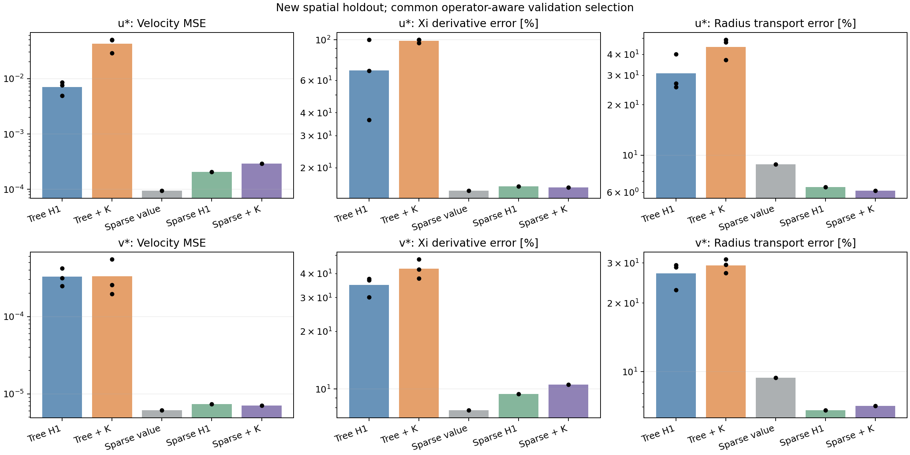

# 算子感知与稀疏结构符号回归

所有主表方案均按同一验证算子分数选式：值误差＋归一化 H1＋归一化 K_R。
PySR 是三个搜索种子均值；稀疏模型是确定性结果，未复制成伪三种子。
本轮为新划分下的同算例空间留出，历史上已分析过此 CFD 场；不属于全新算例盲测。

|分量|方法|速度 MSE|ξ 导数误差|η 导数误差|梯度误差|K_R 误差|
|---|---|---:|---:|---:|---:|---:|
|u|pysr_h1|0.00701253|68.11%|22.02%|25.86%|30.82%|
|u|pysr_operator|0.0426871|98.73%|39.88%|43.70%|44.36%|
|u|sparse_value|9.46666e-05|15.00%|10.04%|10.27%|8.83%|
|u|sparse_h1|0.000206566|15.87%|7.53%|8.01%|6.47%|
|u|sparse_operator|0.000291431|15.64%|8.37%|8.76%|6.14%|
|v|pysr_h1|0.000327144|34.91%|19.89%|22.96%|27.01%|
|v|pysr_operator|0.000332886|42.47%|23.56%|27.31%|29.27%|
|v|sparse_value|6.14299e-06|7.75%|9.95%|9.65%|9.39%|
|v|sparse_h1|7.37336e-06|9.43%|6.95%|7.38%|6.76%|
|v|sparse_operator|7.08507e-06|10.53%|7.06%|7.69%|7.06%|

训练/验证/测试点数：{'train': 930, 'validation': 248, 'test': 248}。

稀疏字典 q=Σ a_ij T_i(ξ−4)T_j(η/1.9)，ξ 阶数在 1/2/3、η 阶数在 6/8/10/12 中用验证集选择；8/12/16/20/24 项预算同样只用验证集选择。
项数与 PySR 节点复杂度不可直接等同；实际 SymPy 操作数及各组验证候选均已保存。改结构、词典和系数求解器的收益不能全部归因于 K_R 损失。
K_R=−(ξqξ+ηqη)/R，只是坐标输运项，不是总参数响应。参考来自数值 CFD 差分，savgol5_stability 为额外参考稳定性诊断。

完整固定设置与指纹见 protocol.json，全部测试表见 test_metrics.csv，表达式与系数见各目录 selection.json。
