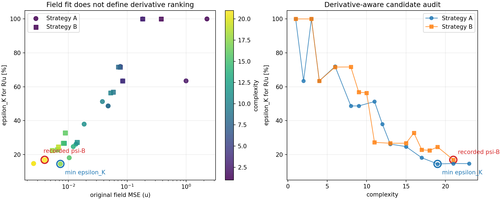

# Stream-function Pareto gradient audit

This is a zero-training retrospective audit of every saved Strategy A/B candidate. The primary metric is `epsilon_K_R_u` against `K_emp=S-M` on the current `33 x 64` FD grid.

## Main result

- Recorded psi-B: `B-E14-C21`, epsilon_K=`0.1687`, closure=`0.4585`.
- Minimum epsilon_K: `A-E12-C19`, epsilon_K=`0.1445`, closure=`0.3926`.
- Minimum original u-MSE candidate: `A-E14-C23`, epsilon_K=`0.1464`.
- `argmin epsilon_K != recorded selection`: `True`.
- Epsilon improvement: `2.42` percentage points (`1.17x`).
- The derivative-best candidate has `1.85x` the recorded candidate's u-MSE, so this is a direct pairwise ranking inversion.
- Across all candidates, Spearman(original u-MSE, epsilon_K)=`0.944`; MSE is broadly informative but not a sufficient final selection metric.

## Best candidates by R/u transport error

| candidate | complexity | original u MSE | epsilon_K R/u | closure R/u | K corr R/u |
|---|---:|---:|---:|---:|---:|
| A-E12-C19 | 19 | 0.00731932 | 0.1445 | 0.3926 | 0.9861 |
| A-E14-C23 | 23 | 0.00256161 | 0.1464 | 0.3977 | 0.9859 |
| A-E13-C21 | 21 | 0.00257141 | 0.1470 | 0.3995 | 0.9858 |
| B-E14-C21 | 21 | 0.00395485 | 0.1687 | 0.4585 | 0.9812 |
| A-E11-C17 | 17 | 0.0103441 | 0.1808 | 0.4913 | 0.9783 |
| B-E12-C18 | 18 | 0.00530581 | 0.2243 | 0.6094 | 0.9839 |
| B-E11-C17 | 17 | 0.00650816 | 0.2280 | 0.6194 | 0.9685 |
| B-E13-C19 | 19 | 0.00676831 | 0.2446 | 0.6646 | 0.9676 |
| A-E10-C15 | 15 | 0.0121173 | 0.2467 | 0.6704 | 0.9754 |
| A-E9-C13 | 13 | 0.0134774 | 0.2615 | 0.7106 | 0.9730 |

## Interpretation boundary

The same empirical transport field is used to rank and report the candidates. This establishes whether the saved search already contains a derivative-better equation, but it is not an out-of-sample validation of derivative-aware selection.

