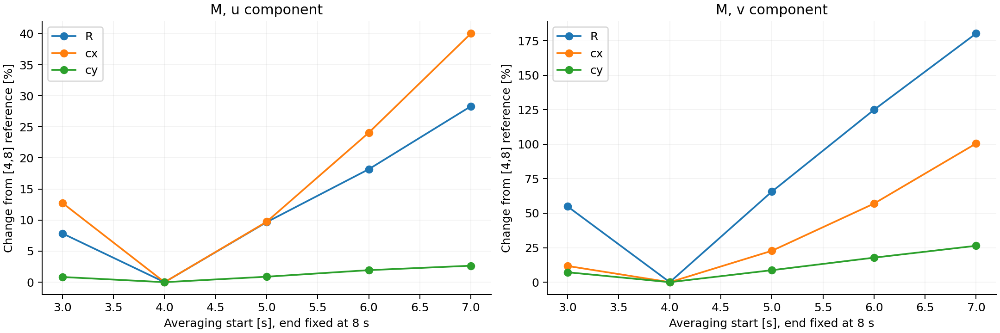
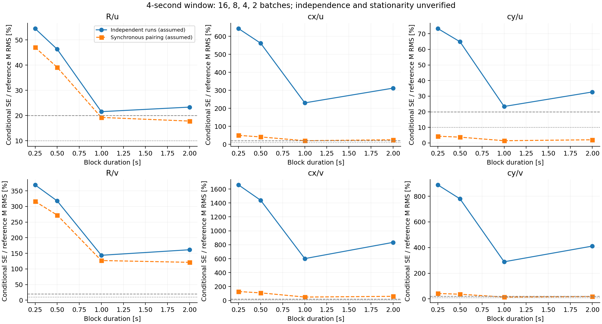
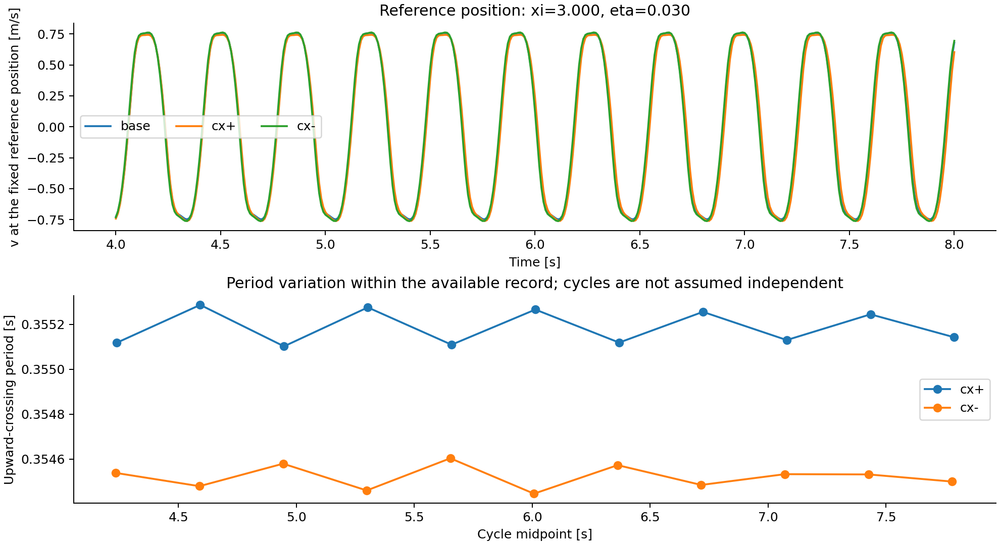

# 原始时序、M 标签与空间导数可靠性审计

日期：2026-09-09。

**主要发现：现有标签的有限时间平均协议对周期截断敏感，流向二阶空间导数对后处理方式敏感。两项因素都应在下一轮 A0 训练之前处理。此次没有新增 CFD，也没有用新的周期平均结果覆盖旧标签；cx 的参数步长和 CFD 网格收敛性仍未验证。**

本次从七组原始 COMSOL 文件重读 u/v 时序，重新插值和时均，审计六项 M；比较统计块、平均窗口、完整周期平均、空间求导方式及规则网格抽稀。代码、原始文件 SHA256、数值结果和图均已保存。

## 1. 数据、参数路径和独立复现

| 项目 | 本次确认的内容 |
|---|---|
| 原始文件 | `cylinder_flow_result`、R±、cx±、cy±，约 5.35 GB |
| 时间 | 每组 801 帧，0–8 s，输出间隔 0.01 s |
| 旧时均 | 索引 `[400:801]`，4.00–8.00 s，401 帧等权平均 |
| 参考网格 | ξ×η 为 33×64，2112 点；各算例按自身 D/cx/cy 映射到相同参考位置 |
| 几何步长 | 项目 CASE 配置给出 h_R=0.001 m、h_cx=h_cy=0.002 m |
| 速度归一化 | 各算例入口附近节点的时均 u 均值，与旧流程一致 |
| 插值 | 在原始节点上构造线性插值；所有参考点在凸包内，未使用最近邻填补 |
| 网格运动 | 重复导出的 x/y 坐标在各自时序中未发生可检测变化 |
| 复现 | 七组原始节点时均与缓存吻合；六项 M 与旧存档最大相对差 1.70×10⁻¹³ |

复现结果说明旧标签可以从现有原始数据正确重建，不证明它已经等于连续 PDE 的真灵敏度。参数、入口控制和几何映射使用项目既定配置；导出表不提供足够的黏度、求解残差、网格独立性或联合随机采样元数据来认证这些物理与统计前提。

R 仍沿 `Umax·D≈0.15` 的入口控制路径变化；本次没有把它重新解释为入口速度固定的半径偏导。压力列在原始导出中存在，但此次仅审计 u/v，未计算压力梯度。

## 2. 平均窗口改变会显著改变 M

下表相对变化统一定义为 `||M_variant−M_[4,8]||₂ / ||M_[4,8]||₂`。两秒窗口包含两个端点，共 201 帧。每个窗口均按其自身入口时均重新归一化；与冻结各算例 4–8 s 入口尺度的结果近乎一致，全部窗口指标差异最大约 1.32×10⁻⁶（相对误差数值单位）。本例窗口敏感性主要不来自入口尺度随时间变化。

| 目标 | 改用 4–6 s | 改用 6–8 s | 仅去掉 8.00 s 最后一帧 |
|---|---:|---:|---:|
| R/u | 19.00% | 18.19% | 2.10% |
| R/v | 130.64% | 124.96% | 14.21% |
| cx/u | 24.60% | 24.07% | 2.30% |
| cx/v | 58.23% | 56.96% | 5.92% |
| cy/u | 1.91% | 1.94% | 0.12% |
| cy/v | 17.38% | 17.78% | 1.24% |

以上是**对平均协议的敏感性**，不是统计误差真值、置信区间或参数差分截断误差。不能据此把 cx 既有拟合误差全部归因于标签噪声。但 cx/v、R/v 的标签明显依赖平均窗口，直接把它们当作稳定的 10% 精度参照是不充分的。



## 3. 当前时序具有强周期性，普通统计块没有建立独立性

4–8 s 的能量频谱主峰在 2.75 Hz 的离散频率格点；频率分辨率为 0.25 Hz。利用同一参考点的 v 向上交叉事件，得到更细的周期估计：

| 算例 | 交叉事件平均周期 | 可用完整周期数 |
|---|---:|---:|
| base | 0.354494 s | 11 |
| cx+ | 0.355186 s | 11 |
| cx− | 0.354520 s | 11 |
| cy+ | 0.352676 s | 11 |
| cy− | 0.352736 s | 11 |
| R+ | 0.366901 s | 10 |
| R− | 0.343332 s | 10 |

cx 正负算例的自相关第一次过零约在 0.09 s，但在 1–2 s 滞后区间内，绝对自相关的最大值仍约为 0.998–0.999。**第一次过零不能在这里解释为已经失去相关性。** 正相关首瓣积分时间约 0.053 s 也只是描述量，不适合直接代入独立样本数公式来认证误差。

为了使用等长统计块，统计块计算采用 4.00–7.99 s 的 400 帧。省去的端点对 M 的影响已经在上表独立量化，没有把 400 帧结果混作旧 401 帧标签。

以 cx 为例，冻结各算例入口尺度，按样本块方差除以块数计算条件标准误，并将其点值方差做空间平均后开方：

| 块长 | 块数 | 假设正负算例独立：u / v | 假设同步配对：u / v |
|---|---:|---:|---:|
| 0.25 s | 16 | 642.80% / 1658.09% | 49.66% / 128.82% |
| 0.50 s | 8 | 561.71% / 1438.33% | 41.00% / 109.66% |
| 1.00 s | 4 | 230.24% / 601.27% | 19.93% / 49.51% |
| 2.00 s | 2 | 311.99% / 834.08% | 25.18% / 59.88% |

百分比的分母为相应旧 M 场的 RMS。它们不是 95% 区间，不是实际误差下界，也不是可以从模型误差中直接减掉的噪声量。两种假设差异很大，且块长没有提供稳定、经验证的独立块估计；短块切断周期，长块只剩 2–4 个。

因此本次**没有选择某一个块长作为“有效统计块”，也没有认证随机标准误**。对于这组近周期时序，完整周期平均的稳定性比直接套用独立块公式更有解释力。若后续要报告概率区间，需明确误差总体是随机初相位、共同随机起点、独立运行还是其他采样机制，并建立相应协方差模型。



## 4. 完整周期平均明显更稳定，但尚不是新的真值

采用基准场 v 在 4–8 s 内时间方差最大的一个参考位置，ξ=3、η≈0.030159，并在所有算例冻结该位置。各算例以自身 v 均值的向上交叉定义周期，端点作线性时间插值，对每个样本间隔的线性信号用梯形积分计算平均，再按同一时间区间的入口平均归一化。

这与原来的固定 4–8 s 等权平均是不同的平均泛函。它是周期统计目标的候选协议；若研究目标本来就指定固定有限时窗，应保留原目标，不能用周期平均悄悄替换。

| 目标 | 完整周期 M 相对旧 M 的变化 | 前后周期组 M 差异 / 完整周期 M 范数 |
|---|---:|---:|
| R/u | 12.00% | 0.042% |
| R/v | 79.89% | 0.233% |
| cx/u | 11.96% | 6.63% |
| cx/v | 32.37% | 3.57% |
| cy/u | 1.15% | 0.059% |
| cy/v | 11.24% | 0.475% |

11 周期的组分为前 5、后 6 个周期；10 周期分为前后各 5 个。前后组之间不假设独立，该指标表示时间段稳定性。第二列与第三列的分母不同，不能直接当成同一误差口径的改善倍数。

进一步固定候选而不按结果选优，检查上下交叉两种方向、均值及均值±0.5 标准差三种交叉阈值，共六种相位约定：

| 目标 | 相位约定变化引起的最大 M 变化 | 将已有时间采样抽稀至 0.02 s 的 M 变化 |
|---|---:|---:|
| R/u | 0.051% | 0.056% |
| R/v | 0.489% | 0.782% |
| cx/u | 0.726% | 0.131% |
| cx/v | 1.021% | 0.381% |
| cy/u | 0.021% | 0.007% |
| cy/v | 0.210% | 0.090% |

这些变化的分母统一为主周期协议的 M 范数。时间抽稀检验的是**已导出时序的积分/事件提取稳定性**，不等于 CFD 内部积分时间步收敛。

完整周期平均的相位稳定性、小的周期内时段差异，以及与旧标签的较大差异，共同支持“周期窗口截断是现有标签敏感性的重要来源”。但是 cx/u 前后周期组仍有 6.63% 差异，且没有新的 h/网格数据，不能据此声称标签已经达到 3% 或 10% 真值精度。

基准场自身也随平均协议变化：周期平均相对旧平均，u 场变化约 0.53%，v 场约 8.69%。因此若采用周期统计目标，应同时更新基准场、空间导数、K、扰动均场和 M/T，保持整条链的一致性。



## 5. 二阶空间导数对求导方式非常敏感

这部分仍固定使用旧 4–8 s 基准均场，以隔离空间后处理的影响。比较：连续 `np.gradient`、两个方向上 5 点/9 点三次 Savitzky–Golay 局部多项式平滑后求导、三次张量积插值/平滑样条。下表去除四周各四个网格点，避免把全部差异归因于最外侧边界。

相对变化均以原 `np.gradient` 的对应导数字段为分母；它衡量方法差异，**没有把 `np.gradient` 指定为真导数**。

| 分量与方法 | 速度值变化 | ξ 一阶导数变化 | ξξ 二阶导数变化 | ξη 混合导数变化 |
|---|---:|---:|---:|---:|
| u，5 点局部多项式 | 0.129% | 11.20% | 80.22% | 44.07% |
| v，5 点局部多项式 | 0.426% | 6.21% | 64.28% | 33.16% |
| u，9 点局部多项式 | 0.151% | 12.77% | 92.79% | 56.43% |
| v，9 点局部多项式 | 0.501% | 7.40% | 77.63% | 44.64% |

将同一插值场在 ξ、η 方向均每隔一个点抽稀，比较相同内域物理位置，原 `np.gradient` 的一/二阶导数变化为：

| 分量 | ξ | η | ξξ | ξη | ηη |
|---|---:|---:|---:|---:|---:|
| u | 13.41% | 3.82% | 86.71% | 62.50% | 18.00% |
| v | 7.31% | 3.66% | 71.86% | 48.06% | 16.08% |

9 点平滑后 ξξ 的抽稀变化仍约为 u 24.10%、v 23.92%。相对波动尺度 0.01 的样条平滑下约为 u 12.58%、v 3.63%，但平滑增大会抑制细节，单凭抽稀稳定不能判定它更接近 CFD 真梯度。固定点数的局部多项式在粗网格上覆盖更大的物理宽度，因此它的抽稀比较同时涉及滤波尺度变化，不能解释成固定算子的形式收敛阶。

另有明确的数值失败：两个小平滑预算的样条配置抛出 FITPACK 错误；u/v 的另一组极小预算配置虽返回了有限函数值，但 ξξ 导数 RMS 达约 10¹³–10¹⁴，相对原结果异常放大。它们保留在原始诊断表中，用于记录失败，不应作为可用代理。构造解测试通过不能保证任意真实数据上的样条拟合都稳定。

由此可见，A0 中流向二阶及混合导数尚不满足统一的 5%–10% 后处理稳定性要求。直接加大这些量的高阶组合可能放大不稳定性。建议优先比较不含二阶导数的字典，以及经尺度验证的导数版本；有条件时与求解器原生梯度或原始节点上的局部多项式结果对照。

规则网格来自线性插值，线性插值函数本身通常不具有连续二阶导数。当前抽稀/平滑实验不构成 CFD 网格加密实验，不能用于报告物理离散误差或 Richardson 收敛阶。

## 6. 可执行的后续顺序及尚缺数据

1. **先冻结目标平均泛函。** 若目标是充分发展的周期平均响应，使用本次完整周期结果作为候选，延长稳定阶段并检查更多周期组；若目标是固定有限时窗，则固定端点与积分权重，研究对象应明确包含该时窗的相位效应。
2. **再生成一致的训练参照。** 在独立输出目录中同步更新基准均场、K、M/T。先比较旧标签与周期候选标签下的 A0，避免一次同时更换模型和目标后无法归因。本次只保存诊断场，没有执行这一轮训练。
3. **导数先做消融。** 比较去二阶导数、5/9 点平滑导数、有限平滑样条版本。平滑尺度在后续训练内部选择，不能用全部测试 M 标签挑选。
4. **cx 补四个算例形成三个 h。** 已有 h=0.002 m；新增 h=0.001 m 对应 cx=0.199/0.201 m，新增 h=0.004 m 对应 cx=0.196/0.204 m。其余 D=0.1 m、cy=0.2 m、名义 Umax=1.5 m/s 及物性、边界、网格策略、收敛标准保持同一路径。需要同时保留足够的周期数据。
5. **最后才判断中心差分的 h² 收敛。** 先确认每档 h 的平均协议误差和采样/相位敏感性足够小，再比较 M(h/2)、M(h)、M(2h)。本次没有这四个新算例，也没有可直接求解的 `.mph` 模型，因此不报告 cx 的截断偏差或最优 h。

当前裁定：

| 问题 | 裁定 |
|---|---|
| 旧标签是否可从原始时序复现？ | 是，六项最大相对差约 1.70×10⁻¹³ |
| 旧平均协议对所有目标是否稳定在 10% 内？ | 否，多个目标明显依赖平均窗口 |
| 是否已经估得可认证的统计标准误？ | 否，周期相关性和联合采样机制未解决 |
| 完整周期平均是否更值得作为周期统计目标的候选？ | 是，相位约定与前后周期组对照支持，但不是新真值认证 |
| 当前二阶空间导数是否已证明可靠？ | 否，特别是 ξξ、ξη 后处理敏感 |
| cx 的参数步长/CFD 网格收敛是否已验证？ | 否，需要新增数据 |
| 是否能把 A0 的失败全部解释为标签问题？ | 不能；此次识别了应先控制的混杂因素 |

## 7. 复现、检查与产物

在项目根目录执行：

```powershell
$env:OPENBLAS_NUM_THREADS='1'
$env:OMP_NUM_THREADS='1'
$env:MKL_NUM_THREADS='1'
& 'D:\keyan\Anaconda\python.exe' -u experiments/a0_label_reliability.py
& 'D:\keyan\Anaconda\python.exe' -u experiments/a0_cycle_average_diagnostic.py
```

首个脚本默认复用带来源大小、修改时间、SHA256 和参考网格记录的本次时序缓存；`--rebuild` 可强制重新读取七组原始文本。第二个脚本依赖第一个脚本生成的时序缓存。

实际完成的独立数值检查：二次构造场的一二阶导数、带时间/分量尾维的仿射场插值、统计块方差展开恒等式、带非网格端点的线性信号时间积分、正弦周期交叉事件。两套完整脚本均成功完成；三张图已检查排版。数值自检仅验证实现，不认证物理灵敏度。

- [主审计脚本](../experiments/a0_label_reliability.py)
- [周期平均及相位审计脚本](../experiments/a0_cycle_average_diagnostic.py)
- [原始来源与审计清单](../outputs/a0_label_reliability_2026-09-09/audit_manifest.json)
- [原始时序重建结果](../outputs/a0_label_reliability_2026-09-09/raw_reproduction.csv)
- [时窗敏感性](../outputs/a0_label_reliability_2026-09-09/mean_window_sensitivity.csv)
- [条件统计块标准误](../outputs/a0_label_reliability_2026-09-09/batch_mean_diagnostics.csv)
- [自相关与频谱尺度](../outputs/a0_label_reliability_2026-09-09/temporal_scales.csv)
- [周期平均 M 指标](../outputs/a0_label_reliability_2026-09-09/cycle_mean_responses.csv)
- [周期相位与时间抽稀检查](../outputs/a0_label_reliability_2026-09-09/cycle_mean_phase_robustness.csv)
- [周期定义、事件及来源清单](../outputs/a0_label_reliability_2026-09-09/cycle_mean_manifest.json)
- [空间导数方法敏感性](../outputs/a0_label_reliability_2026-09-09/gradient_method_sensitivity.csv)
- [空间抽稀敏感性](../outputs/a0_label_reliability_2026-09-09/gradient_resampling_sensitivity.csv)
- [样条求解器异常记录](../outputs/a0_label_reliability_2026-09-09/spline_fit_failures.json)

方法文献及原计划见文献与 A0 行动方案（本地历史文档：`reports/a0_literature_action_plan_2026-09-09.md`）。本次未修改主流程、旧训练数据和历史结果。
