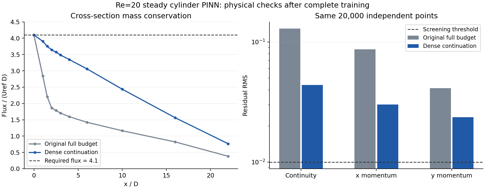

# 圆柱绕流 PINN 完整训练记录（2026-09-22）

完整训练与加密续训均已执行完毕；续训仍未通过必要物理筛查，不能将其作为物理收敛解或可信升阻力基准。

本次计算是 **Re=20 稳态圆柱绕流**。网络为 4×64 tanh MLP，输出 u、v、p，使用 float64 和 RTX 4060 Laptop GPU；未使用 CFD 观测标签。几何、方程、损失权重和随机种子在两轮间保持一致。

## 两轮结果

| 指标 | 原配置完整训练 | 加密采样续训 |
|---|---:|---:|
| Adam 步数 | 10000 | 2000 |
| L-BFGS 步数 | 1000 | 5000 |
| L-BFGS 闭包求值次数 | 2056 | 10323 |
| 内部点 / 每段边界点 | 2048 / 256 | 8192 / 512 |
| 训练用时（分钟） | 8.88 | 19.28 |
| 最终训练损失 | 0.00872351 | 0.00185335 |
| 原始程序验证损失 | 0.0235319 | 0.00489887 |
| 连续性残差 RMS | 0.129382 | 0.0439207 |
| x 动量残差 RMS | 0.0870392 | 0.0301063 |
| y 动量残差 RMS | 0.0412814 | 0.0236708 |
| 入口流量 | 4.09151 | 4.09827 |
| 出口流量 | 0.382557 | 0.766192 |
| 最大截面流量相对误差 | 90.669% | 81.312% |
| 下壁速度分量 RMS | 0.00275918 | 0.00147783 |
| 上壁速度分量 RMS | 0.00329635 | 0.00141225 |
| 圆柱表面速度分量 RMS | 0.00323391 | 0.00127953 |
| Cd（应力积分，未作 CFD 精度认证） | 0.912671 | 4.54948 |
| Cl（应力积分，未作 CFD 精度认证） | 0.283133 | 0.159093 |

两轮累计执行 12,000 步 Adam 和 6,000 步 L-BFGS。续训从首轮最终权重开始，Adam 学习率由 1e-3 降至 1e-4；内部采样点增至 8,192，每段边界点增至 512，L-BFGS 历史长度增至 100。权重热启动重置了优化器状态。

## 独立检查方法

两轮均使用相同随机种子 20260923、相同 20,000 个独立流体域内部点检查 NS 残差；用 4,097 个 y 方向点积分多个截面的流量，圆柱内部的积分贡献设为零。理论入口流量为 4.1。上下壁使用 4,097 点、圆柱边界使用 4,096 点检查速度误差。

必要筛查阈值：最大截面流量相对误差 <1%，各方程残差 RMS <0.01，无滑移速度分量 RMS <0.01，入口速度误差和出口牵引分量 RMS <0.01。这些阈值是本次训练诊断标准，不是通用精度保证。原程序的验证点数随训练配置改变，跨轮比较应优先使用本报告的共同独立检查。

升阻力分别用 256、512、1,024、2,048 个圆周积分点复核。积分加密稳定只能排除积分离散误差，不能排除网络速度梯度或压力场误差。详细分项见 dense_audit.json。

## 对比图



蓝线仍沿通道显著下降，表明累计质量守恒误差没有消除；三个独立残差 RMS 也仍高于本次筛查阈值。

## 文件与复现

- 原配置完整训练目录：`outputs_pinn/cylinder/20260922_225500_re20_full`。
  - 最终权重：原配置完整训练 checkpoint（本地运行产物：`outputs_pinn/cylinder/20260922_225500_re20_full/checkpoint_last.pt`）
  - 诊断：[dense_audit.json](assets/pinn/cylinder/20260922_225500_re20_full/dense_audit.json)
  - 流场：[fields.png](assets/pinn/cylinder/20260922_225500_re20_full/evaluation/fields.png)
  - 训练曲线：[training_loss.png](assets/pinn/cylinder/20260922_225500_re20_full/training_loss.png)
  - 权重 SHA-256：`34c681b131ad6b33522cbdc07dcecfed44efc74977bea5d149daf47f796c90af`。
- 加密采样续训目录：`outputs_pinn/cylinder/20260922_230817_re20_refined`。
  - 最终权重：加密采样续训 checkpoint（本地运行产物：`outputs_pinn/cylinder/20260922_230817_re20_refined/checkpoint_last.pt`）
  - 诊断：[dense_audit.json](assets/pinn/cylinder/20260922_230817_re20_refined/dense_audit.json)
  - 流场：[fields.png](assets/pinn/cylinder/20260922_230817_re20_refined/evaluation/fields.png)
  - 训练曲线：[training_loss.png](assets/pinn/cylinder/20260922_230817_re20_refined/training_loss.png)
  - 权重 SHA-256：`e26e8731ca52561bcb7423e95001fd104f8275dea13c907d5b011db9319976d9`。

```powershell
& 'D:\keyan\Anaconda\envs\deeplearning\python.exe' scripts/audit_pinn_cylinder.py `
  --run-dir outputs_pinn/cylinder/20260922_230817_re20_refined --device cpu
```

最终 checkpoint、config.json、history.csv、environment.json、training_status.json 以及原始日志均保留。environment.json 记录源代码哈希，续训还记录了父检查点路径。

## 后续改进的依据

当前结果用于保留普通 u-v-p PINN 的实际基线表现。本次质量守恒仍不合格，后续应优先研究整体流量约束、流函数形式的严格不可压缩表示、分区/近壁采样或针对连续性方程的损失平衡，并与本次完整预算结果使用相同独立检查比较。修改方法后的结果应单独归档，避免与普通基线混为一谈。
