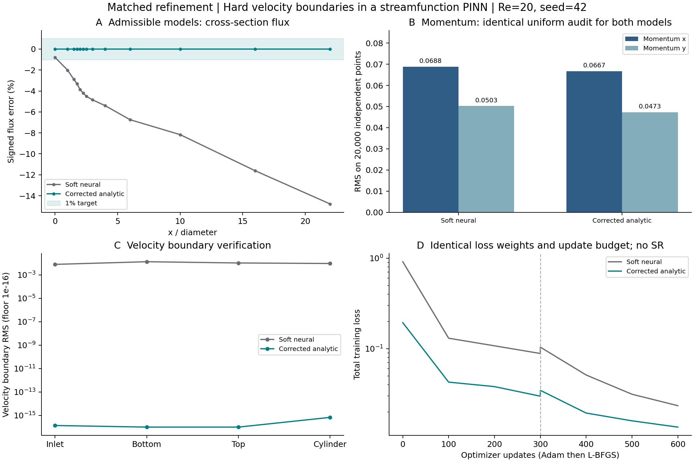
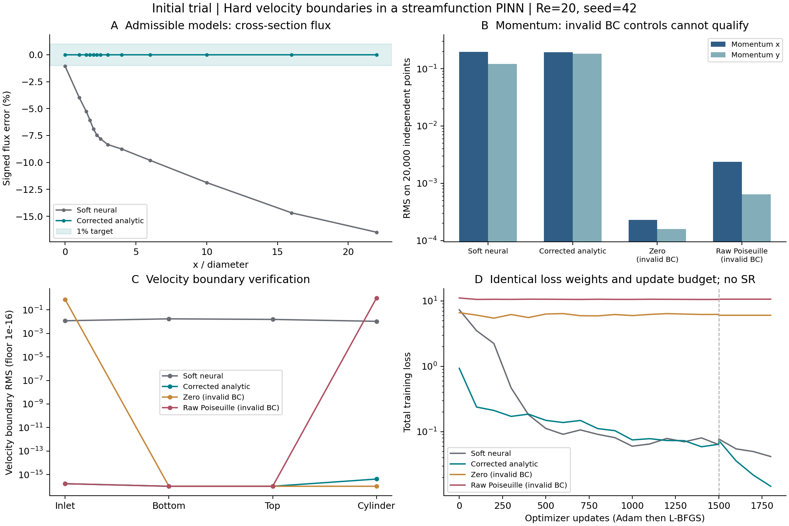

# 硬边界流函数基线与背景消融（2026-10-13）

**达到本任务的两项成功门槛，但首次 1500 Adam＋300 L-BFGS 预算没有全部通过。** 最终完成两轮对称精修后，解析修正背景的最大截面流量误差为 **0.0000185541%**，两个动量残差均不高于同预算纯神经流函数；新的独立均匀审计也通过。两种有效模型都累计使用 **2300 Adam＋900 L-BFGS**，包括两次优化器重置。

全程没有使用 SR。对本算例和下述完整协议，**手工解析背景＋齐次神经修正已足够达到这些门槛，SR 是可选项**；本实验不构成 SR 额外收益的证据。

## 1. 最终同预算结果

Re=20 稳态，训练 seed=42，4×64 tanh，float64，2048 内部点／每段 256 边界点，无 CFD 数据损失。纯神经模型 12802 个参数，硬边界模型 12803 个参数；多出的一个是决定圆柱上下通量分配的流函数常数 C。

| 指标 | 纯神经流函数 | 解析硬边界 |
|---|---:|---:|
| 最大截面流量误差，沿用 4097 点积分 / % | 14.784983 | **0.0000185541** |
| 按圆柱交点切分的 Gauss 积分误差 / % | 14.784978 | **1.29977e-13** |
| momentum_x RMS，原审计点 | 0.0688292 | **0.0667174** |
| momentum_y RMS，原审计点 | 0.0502953 | **0.0473370** |
| momentum_x RMS，新审计点 | 0.0634637 | **0.0503773** |
| momentum_y RMS，新审计点 | 0.0468973 | **0.0423321** |

两套审计各含 20000 个全域均匀点，种子分别为 `20260923` 和在最后阶段训练前固定的 `20261015`。训练加密分布没有传入全域审计。两套点均要求 x、y 两个分量分别不劣于对照，没有用总损失替代动量判据。

为防止对照退化造成“过关”，最终模型还同时对比首轮纯神经模型：原审计 `0.197469 / 0.121352`，新审计 `0.177272 / 0.117382`，四项保护条件也全部通过。历史 9-23 的 15.613% 是旧运行值；本次同配置首轮复跑为 16.475724%，不将两者混作同一次结果。

最终硬边界入口速度最大绝对误差 `4.44e-16`，上下壁面为零，圆柱为 `4.02e-15`；连续性 RMS `4.41e-16`。Gauss 积分与流函数端点差相符，原密集积分的剩余流量误差属于数值积分误差。圆柱常数最终为 `C=1.96343230225`。



## 2. 保留未达标阶段与完整预算

| 阶段 | 两组共同追加的预算 | 内部点分配 | 执行设备 |
|---|---|---|---|
| 首轮 | 1500 Adam＋300 L-BFGS | 2048 全域均匀 | RTX 4060 Laptop GPU |
| 圆柱精修 | 500 Adam＋300 L-BFGS | 1024 全域＋1024 圆柱环带 | CPU，每组单线程 |
| 入口与圆柱联合精修 | 300 Adam＋300 L-BFGS | 1024 全域＋512 圆柱环带＋512 入口条带 | CPU，每组单线程 |

圆柱环带半径 `[0.5,1.5]`，按半径和角度均匀采样；入口条带为 `[0,1]×[0,4.1]`。每阶段，两种有效模型使用相同采样序列、物理权重、网络宽度、学习率和优化器设置，后续阶段从各自完成的 checkpoint 开始。更新预算相同，不代表耗时或 FLOPs 相同。

首轮硬边界的流量已达标，但 y 动量 RMS `0.181905` 高于纯神经的 `0.121352`，所以首轮结论是**未全部达标**。高残差集中在圆柱周围；其训练批次 y 动量 MSE 为 `0.003006`，均匀审计 MSE 却约为 `0.033089`，不能凭较低训练损失判断成功。

圆柱精修后，近圆柱误差下降，但入口附近出现峰值。硬边界 y 动量 RMS 为 `0.167152`，纯神经为 `0.370570`；硬边界虽赢得该阶段对照，仍未达到首轮纯神经标准，因此没有据此宣布成功。最后同时覆盖入口和圆柱后，才通过上表全部比较。

这些是根据先前诊断逐步制定的探索性精修，不是预先一次性固定的全部协议。跨阶段同时改变了预算和采样，不能把跨阶段改善全部归因于采样加密，也不能把精修后的硬边界与未精修软边界包装成同预算优势。后续 SR 实验应冻结这里的完整协议，再比较符号项。

## 3. 同一个 D 的背景消融

以下四组都完整跑完首轮 1500 Adam＋300 L-BFGS，使用相同神经初始化、样本序列和损失权重。三个硬因子组的 D 完全相同。

| 首轮模型 | 分段积分最大流量误差 / % | momentum_x RMS | momentum_y RMS | 边界解释 |
|---|---:|---:|---:|---|
| 纯神经流函数 | 16.475719 | 0.197469 | 0.121352 | 软壁面仍漏流 |
| D＋零背景 | 100 | 0.000230939 | 0.000159867 | 强制零通量，入口错误 |
| D＋原始 Poiseuille | 35.838134 | 0.00237445 | 0.000640851 | 圆柱仍有非零速度 |
| D＋圆柱修正的解析背景 | 1.08314e-13 | 0.192819 | 0.181905 | 速度边界精确，首轮 y 动量未达标 |

零背景的入口速度 RMS 为 `0.774502`，原始 Poiseuille 的圆柱速度 RMS 为 `1.028761`。这两项由 ansatz 固定，网络训练无法修正：D 及其一阶导数在相应边界均为零。两组低动量残差对应的是边界问题错误的场，不能据此认定圆柱绕流解更好。

因此，字面意义的零背景和原始 Poiseuille 都是**不可满足指定边界的负对照**。若零背景额外保留非齐次边界 lifting，它就不是总背景为零的同一个消融。原始 Poiseuille 必须补上圆柱修正；这项修正完全可以解析构造，无需 SR。



## 4. 构造与实现

使用 `ψ=ψ_bg(C)+D Nθ`，`u=ψ_y, v=−ψ_x`。以 Poiseuille 流函数 `P(y)` 承担通量，构造

```text
w = A/(A+B)
D = AB/(A+B)
ψ_bg = P(y) + w[C−P(y)]
```

A 在入口、上下壁面二阶消失；B 在圆柱二阶消失。圆柱不接触外边界，故分母在流体闭包内严格为正，D 和背景均光滑。D 与 ∇D 同时为零才保证齐次速度修正；仅有 D=0 不够。这里是由距离定义函数构造的光滑消失因子，不是全域精确的最近边界距离。

圆柱上 `ψ=C`，下壁 `ψ=0`，上壁 `ψ=H`。截面穿过圆柱时，两个流体区间的通量分别为 C 和 H−C，总和仍为 H。C 是未知的流量分配常数，默认可训练；它不是可以任意固定的全局 gauge，其变化仍满足齐次速度边界。压力继续由神经网络输出，出口 Cauchy 牵引保持原软损失。

完整公式、配置与三阶段复现命令见 [实现说明](../docs/pinn_hard_boundary.md)。核心在 [pinn/model.py](../pinn/model.py)，训练采样在 [pinn/problems.py](../pinn/problems.py)，驱动在 [run_hard_boundary_trial.py](../scripts/run_hard_boundary_trial.py)。

## 5. 验证、产物与结论边界

67 项 PINN 回归测试通过，覆盖任意神经权重下的精确边界、分段通量、三阶导数及反传、两种推理上下文、Adam/L-BFGS、checkpoint 重载、并行目录隔离、训练加密不改变均匀审计、warm start 线程恢复。9-23 原流函数 checkpoint 在 257 个存档点上的重载最大差异为 `1.776e-15`。

- [首轮四组原始结果](assets/pinn/cylinder/hard_boundary_trial_20261013/comparison.json)
- [圆柱精修原始结果](assets/pinn/cylinder/hard_boundary_refined_20261013/comparison.json)
- [最终结果与全部验收分项](assets/pinn/cylinder/hard_boundary_inlet_refined_20261013/comparison.json)
- 最终硬边界 checkpoint（本地运行产物：`outputs_pinn/cylinder/hard_boundary_inlet_refined_20261013/cylinder_poiseuille/checkpoint_last.pt`）；同预算纯神经 checkpoint（本地运行产物：`outputs_pinn/cylinder/hard_boundary_inlet_refined_20261013/soft/checkpoint_last.pt`）
- [轻量证据、配置一致性与哈希核对](pinn_hard_boundary_2026-10-13.json)

每轮均保留进程启动时的 `source/` 快照、原配置、训练历史和 checkpoint 哈希。持续开发时，首轮部分 `environment.json` 读取的磁盘哈希对应较新文件，而已运行进程仍使用启动时导入的模块；原记录未改写，差异明确记入 `execution_source_manifest.json`，复现以对应轮次的源码快照为准。

**本任务的相对验收通过，不等同于项目更严格的完整物理筛查通过。** 最终动量 RMS 仍高于 0.01，出口牵引 RMS 约为 0.03005，也未达到该筛查阈值；没有独立 CFD 场或升阻力精度认证。训练仅有 seed=42，两个空间审计种子不等于多训练种子复现。

后续“SR 帮 PINN”的对照应使用已相容的解析 lifting、同一个 D、同样的自由常数处理与完整训练协议。当前结果支持先修复硬边界底座；它不支持把边界修正带来的收益记到 SR 名下。
