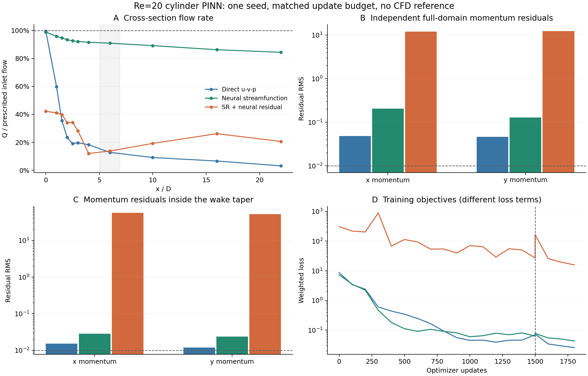
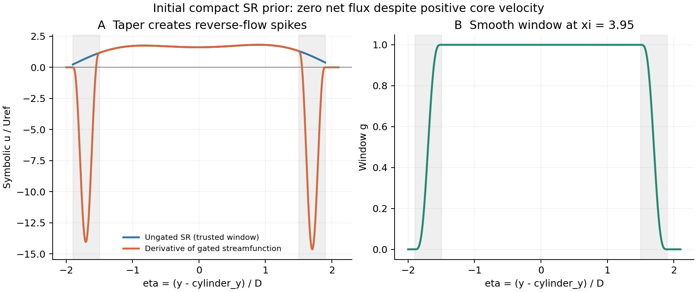

# 符号流函数＋神经残差 PINN 试验（2026-09-23）

本次结果支持流函数的无散硬约束，但不支持当前局部门控 SR 方案具有额外收益。 三组均完成 **1,500 步 Adam＋300 步 L-BFGS**，不是冒烟运行，也不是默认 10,000＋1,000 的完整预算。

## 1. 实现与试验范围

核心实现位于 [pinn/model.py](../pinn/model.py)，新增 `SympyTorch`、C³ 尾流门函数、`StreamFunctionMLP` 和统一构造入口。`losses.py` 对流函数模型删除连续性训练项，增加窗口内神经残差范数；`config.py`、`train.py` 只增加架构配置、构造与检查点接线。原 u-v-p 行为保留，物理算子、边界定义和采样器未改。

实际 ansatz 为 `ψ=g·(ψ_SR−ψ_SR(anchor))+Nθ`，`u=ψ_y, v=−ψ_x, p=Pθ`。窗口外是纯神经流函数；不能把衰减门乘在 N 上再声称窗口外纯网络。SR 坐标为 `ξ=x−2, η=y−2`，可信区为 `ξ∈[3,4.9]、η∈[−1.9,1.9]`。门函数的 0.4 宽过渡带位于可信区内部，端点前三阶导数为零。

使用旧 SR 记录 B-E14-C21，将可去奇点代数消除，精修五个显式系数；以有界参数化保证这条公式的分母在允许参数与空间范围内大于 0.4。源数据为 **未知 Re 的 COMSOL 时均场**，只迁移为结构先验，未用作 Re=20 稳态观测。

三组均为 Re=20 稳态、4×64 tanh、float64、RTX 4060 Laptop GPU、seed=42、2,048 内部点／每段 256 边界点，相同物理权重和采样序列；无 CFD 数据损失。纯流函数和混合流函数的神经部分初值相同。参数量略不同；相同更新次数不等于相同时间或 FLOPs。

实现说明与完整运行命令见 [pinn_hybrid_streamfunction.md](../docs/pinn_hybrid_streamfunction.md)。

## 2. 同预算结果

| 指标 | 原 u-v-p | 纯神经流函数 | SR＋神经残差 |
|---|---:|---:|---:|
| 可训练参数量 | 12867 | 12802 | 12807 |
| 初始训练损失 | 8.70819 | 7.34091 | 307.695 |
| 最终训练损失 | 0.0258892 | 0.0431929 | 15.8023 |
| 独立验证损失（各自目标） | 0.026049 | 0.0701912 | 386.667 |
| continuity RMS（独立 20,000 点） | 0.14158 | 1.5934e-16 | 5.5863e-15 |
| momentum_x RMS（独立 20,000 点） | 0.0482 | 0.20461 | 11.981 |
| momentum_y RMS（独立 20,000 点） | 0.046117 | 0.12833 | 12.309 |
| 最大截面流量相对误差 | 96.846 | 15.613 | 87.981 |
| 训练耗时 / s | 98.24 | 169.65 | 640.88 |
| L-BFGS 闭包求值次数 | 609 | 612 | 622 |

流量误差这一行的单位为 %；验证目标包含不同的损失项，不能用总损失单独判断精度。



| 指标 | 原 u-v-p | 纯神经流函数 | SR＋神经残差 |
|---|---:|---:|---:|
| inlet_velocity_error RMS | 0.0057145 | 0.012254 | 0.50048 |
| bottom_velocity RMS | 0.0070624 | 0.017376 | 0.23976 |
| top_velocity RMS | 0.0050025 | 0.014217 | 0.27824 |
| cylinder_velocity RMS | 0.011486 | 0.010959 | 0.1683 |
| outlet_traction RMS | 0.0013917 | 0.024496 | 0.054462 |

所有模型均未通过现有的完整必要物理筛查：截面流量误差 <1%、各动量残差和边界分量 RMS <0.01。没有独立 CFD 真值，本试验不提供速度场／升阻力精度认证。

## 3. 无散不等于严格截面流量恒定

纯神经流函数的连续性 RMS 为 `1.593e-16`，最大截面流量误差由 u-v-p 的 `96.846%` 降至 `15.613%`，但还未达到 1% 阈值。

纯流函数入口流量 `4.055925`，出口 `3.459856`；壁面净流出 `0.596067`，全部边界净流出仅 `-9.972e-07`。因此剩余流量变化由**软壁面条件允许的漏流**解释，并非连续性硬约束失效。该模型的动量残差仍偏大，不能仅凭无散把它当作准确解。

## 4. 整个流函数的局部截断破坏了初始化

在任一下游截面，符号项 `gψ_SR` 在上下壁面均为零，因此 `∫u_SR,gated dy = [gψ_SR]bottom^top = 0`。平台区的正向速度必须被过渡带反向速度抵消；网络必须独立承担全部净通量并消除这些尖峰。

对初始 `ξ=3.95` 截面，原 SR 在可信区内的 u 为 `0.228～1.811`；加门后最小值为 **`-14.628 Uref`**，符号项积分流量为 `5.73e-11`，符合解析零净通量。初始混合损失 `307.695`，约为纯神经流函数初始损失的 `41.9` 倍。



以下使用窗口内 81×97 网格，独立检查平台区和过渡带；全域随机点均值不足以描述局部尖峰：

| 指标 | 原 u-v-p | 纯神经流函数 | SR＋神经残差 |
|---|---:|---:|---:|
| plateau / momentum_x RMS | 0.018781 | 0.028512 | 3.967 |
| plateau / momentum_y RMS | 0.0113 | 0.026242 | 8.1706 |
| taper / momentum_x RMS | 0.015242 | 0.028403 | 56.273 |
| taper / momentum_y RMS | 0.011891 | 0.02362 | 52.223 |

本实现没有进行全域神经预训练，不能把“加入一个局部 SR 公式”当作 HB-PINN 预训练收益的复现。含 sin/cos 的结构与精确无散也不构成频谱偏差或梯度精度改善的证据。

## 5. 系数与神经残差

| 系数 | 初值 | 精修值 | 位移 / 允许半径 |
|---|---:|---:|---:|
| a | 0.3375839 | 0.25893987 | -0.7864 |
| b | 1.7832861 | 1.91229708 | 0.7234 |
| d | 0.68956524 | 0.757421179 | 0.6786 |
| omega | 0.71782035 | 0.640482996 | -0.7734 |
| phase | 0.054244295 | 0.0559445168 | 0.0170 |

精修半径是 `0.1·max(1,|初值|)`；最后一列接近 ±1 表示接近允许边界。神经残差惩罚为平台区 12×12 固定网格上的 `mean(N²)`，权重 1e-4。最后训练批次的未加权项为 `2.57883`、加权后为 `0.000257883`。

| 区域 | 符号速度 RMS | 神经速度 RMS | 总速度 RMS | 两分量余弦 |
|---|---:|---:|---:|---:|
| plateau | 1.16116 | 1.55884 | 0.892181 | -0.823808 |
| taper | 4.17584 | 4.14242 | 2.02584 | -0.881406 |

余弦为负表示两分量整体存在抵消；接近 −1 表示强烈反向。这里实现的是软范数惩罚，没有实现 OrthoReg，不能声称分解已唯一或解释性已保住。

## 6. 复现与程序验证

- PINN 专项：Python 3.8.20 / PyTorch 2.4.1，35 项通过；高阶导数优化后的完整回归：Python 3.12.11 / PyTorch 2.7.1 CPU，53 项通过。
- 覆盖：SymPy 与 Torch 到三阶导数一致、系数梯度、门函数端点、窗口外奇点、稳态／瞬态无散、`no_grad`／`inference_mode`、正则反传、Adam/L-BFGS 与 checkpoint 重载。
- 原 2026-09-22 加密训练 checkpoint 已重载；257 个点与原保存场的最大差异 `2e-15`。
- 完成结果汇总：[comparison.json](assets/pinn/cylinder/hybrid_trial_20260923/comparison.json)。原始 SR 来源、架构、窗口和精修系数均写入配置及 checkpoint；`symbolic_coefficients.json` 另存可读系数。
- 最初较慢的混合试跑在 Adam 日志到 500 步后终止，**没有作为最终结果**。原日志、配置及源码快照保留。优化为只在窗口内建立符号导数图，并将等价的四边门乘积简化为两轴门；检查所有损失与参数梯度一致后，从相同种子重新完成 1,500＋300 步。记录见 [optimization_check.json](assets/pinn/cylinder/hybrid_trial_20260923/optimization_check.json)。

- 原 u-v-p：checkpoint（本地运行产物：`outputs_pinn/cylinder/hybrid_trial_20260923/uvp/checkpoint_last.pt`）；SHA-256 `ce39b09662106c7f002f68221fca6e1210c8351104004f8f9495c2a2a8cac401`。
- 纯神经流函数：checkpoint（本地运行产物：`outputs_pinn/cylinder/hybrid_trial_20260923/streamfunction/checkpoint_last.pt`）；SHA-256 `4d34df3d40a9a6e9890615a0d25c80dc94784e5e8a34dd4dc09c01e3da20b69b`。
- SR＋神经残差：checkpoint（本地运行产物：`outputs_pinn/cylinder/hybrid_trial_20260923_sparse/hybrid_streamfunction/checkpoint_last.pt`）；SHA-256 `e82ff59164b9e183930ea526b82f8e01db909d305fa017f2c57b8ce7398966ce`。

```powershell
$env:MKL_THREADING_LAYER = 'SEQUENTIAL'
& 'D:\keyan\Anaconda\envs\deeplearning\python.exe' scripts/run_hybrid_pinn_trial.py `
  --out-dir outputs_pinn/cylinder/new_hybrid_trial --device cuda `
  --adam-steps 1500 --lbfgs-steps 300
```

## 7. 下一步的明确修改

保留流函数硬约束。混合项优先改为**相对于匹配背景流的局部修正**，例如 `ψ=ψ_bg+g(ψ_SR−ψ_bg)+Nθ`，其中背景流需正确承载全域通量、对齐流函数 gauge；若必须窗口外纯网络，可先预训练背景网络再混合差值。同时处理壁面不穿透／全域流量，核对 SR 与目标 Re、边界和速度尺度的匹配。

这些是根据本次结果提出的下一轮方案，尚未实施或验证。当前这条局部门控整流函数路线不能直接作为已有收益的结论。
