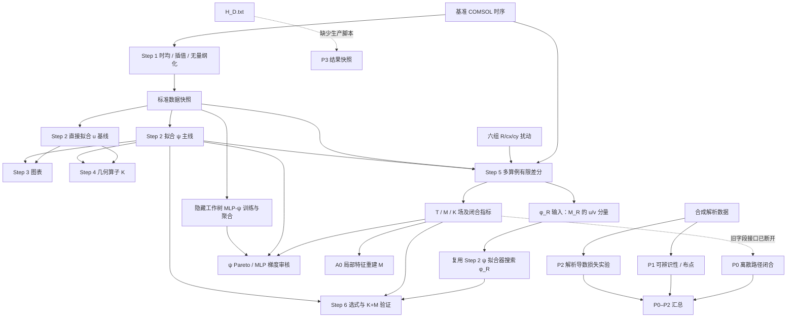

# 项目结构、代码审核与关系梳理

审核日期：2026-09-08。工作区：`D:\keyan\cylinder_flow_pisr`。当前提交：`9ed3fa0`。

项目已经形成清楚的科研主线，但尚未形成可稳定从头复现的流水线。核心数学算子的实现有验证支撑；主要问题在于文件接口演化后未同步消费者、旧结果与新输入共用目录，以及部分统计结果的解释超出实际验证方式。

本次只新增审核文档和证据，不修改研究代码、不重训模型、不覆盖既有研究产物。进入审核前已有的 `experiments/README.md` 修改、A0 脚本与产物、`.codex/` 未跟踪文件均保留。

## 1. 审核范围与验证方式

- 主目录、`experiments/`、`scripts/`、`reports/`、`archive/` 共 22 个 Python 文件、8,884 行代码通过 AST 语法解析；4 个 PowerShell 启动器通过语法解析。
- 逐项核对主流程 Step 1–6 的输入、输出、坐标和归一化约定，阅读各实验的计算及选式逻辑；报告生成和归档分支侧重入口、依赖、计算口径和复现条件。
- 检查隐藏的 `.claude/worktrees/pinn-baseline/` 中独有的 MLP 训练、聚合和测试代码；运行其中两项既有导数测试，结果为 **2 passed**。该结果只覆盖这两个算子测试，不等于整个主流程通过。
- 读取现有小型 CSV、JSON、NPY、NPZ 进行网格与结果核对。在临时目录复现 B-only 读入失败、P0 字段缺失、训练快照保留旧 A 结果等问题。
- 没有启动 COMSOL、PySR、Julia，没有重新解析约 17.3 GB 的原始导出，也没有重跑全部训练、A0 交叉验证或 P3。未对 Word/PPT 的视觉版式作审核。
- 机器可读证据：[project_audit_2026-09-08_evidence.json](D:/keyan/cylinder_flow_pisr/reports/project_audit_2026-09-08_evidence.json)。隔离检查脚本位于被 Git 忽略的 `.codex_tmp/project_audit_20260908.py`；证据中的临时路径属于已结束的隔离复现。

## 2. 实际目录与职责

| 区域 | 职责 | 当前状态 |
|---|---|---|
| 根目录的 COMSOL 文件 | 基准、R/cx/cy 六组扰动、H/D 原始时序 | 原始输入；已被 Git 忽略；占据绝大多数磁盘空间 |
| `step1_extract_wake_comsol.py` | 宽表读取、后半段时均、插值、无量纲化 | 当前基准数据生产入口 |
| `step2_pisr.py` | 直接拟合 u；A 为值拟合，B 增加连续性残差 | 对照基线，不是流函数主线 |
| `step2_pisr_psi.py` | 搜索 ψ，恢复 u/v；A 只约束 u，B 联合约束 u/v | 当前符号模型主入口，也被 φ_R 复用 |
| `step2_eta_sym.py` | 调用旧速度拟合入口，附加 eta 窗口参数 | 兼容入口；与 Step 1 的对称插值窗不是同一件事 |
| `step3_visualize.py` | Pareto、速度误差、散度和剖面 | 仍带有旧速度拟合流程的计算与标签 |
| `step4_euler_sensitivity.py` | 对闭式 u 计算 Euler/平移算子与自洽性 | 计算的是冻结无量纲场的几何输运项 K |
| `step5_fd_sensitivity_check.py` | 七算例读取、固定物理/参考坐标 FD、T/M/K 对比 | 主流程的多算例验证中心，导出 φ_R 训练目标 |
| `step6_phi_R_analysis.py` | φ_R 选式、响应场恢复、K+M 验证 | 消费 Step 2 和 Step 5 产物；当前存在版本与口径问题 |
| `experiments/` | P0/P1/P2、ψ/MLP 梯度审核、A0 局部重建 | 独立验证分支，不是按文件名顺序执行的第二条流水线 |
| `scripts/` | 本机 deeplearning Python/Julia 启动与依赖设置 | 环境路径绑定本机；setup 会安装 Julia 包 |
| `outputs_mgn/` | COMSOL 标准化输入、符号/MLP 模型、FD、φ_R、图表 | 名字沿用 MeshGraphNets 历史，当前主数据源为 COMSOL |
| `outputs/` | P0–P2、A0、预备实验汇总、阶段汇报 | 研究结果快照，与当前代码版本不总是一致 |
| `outputs_hd_p3/` | H/D=4、8 结果、步长与时间块诊断 | 只有产物和判定文档，缺少主仓库内的重跑入口 |
| `reports/` | 研究方案报告、Word/Markdown 生成器 | 研究路线说明层；生成器含硬编码结论，不是动态结果汇总 |
| `archive/dvdy_substitution/` | 历史 B+g 代入路线及放宽 A 复杂度的对照 | 已退出主流程；记录引用的输出目录当前缺失 |
| `.claude/worktrees/pinn-baseline/` | MLP 训练、聚合、测试，以及若干旧主脚本副本 | 有独有功能但不在主仓库跟踪范围，形成隐性依赖 |
| `.agents/`、`.codex/`、`.idea/`、`.skill-build/`、`.codex_tmp/` | 本机工具、编辑器和临时状态 | 不属于研究模型的核心实现；本次未发现适用的 AGENTS.md |

README 中列出的 `docs/` 实际不存在，`docs/theory_identifiability.md` 为断链。归档 README 提到的历史输出目录也不存在，不能据文件清单推定历史实验可直接复现。

## 3. 数据流与代码关系

重要的是区分两种“依赖”：大部分主脚本并不互相 import，而是通过固定文件名通信；因此 Python 导入和语法检查都通过，仍然可能出现跨步骤失配。主线在 Python 之外，还包含 PowerShell → 指定 conda Python → PySR → Julia 的运行链。

### 标准文件约定

| 文件/字段 | 实际含义 | 消费者 |
|---|---|---|
| `wake_data.csv` | `x_D=ξ`、`y_D=η`、`u_star=u/U_in`；按 x 主序、y 次序排列 | 两种 Step 2、Step 3/4、诊断 |
| `v_mean_wake.npy` | 已归一化的 v/U_in，形状 `(n_x,n_y)` | 两种 Step 2、Step 3、MLP |
| `meta.json` | D、U_in、中心、网格间距、形状、时间窗、来源 | 多个脚本；目前没有统一 schema 校验 |
| `results_strategy_[ab].csv` 的 `sympy` | u 的公式；在 ψ 路线中也是派生后的 u，而非 ψ | Step 3/4 |
| 同表的 `psi_sympy` / `v_sympy` | ψ 与派生 v 的公式 | Step 5/6、ψ 审核 |
| `fd_sensitivity_fields.npz` | 半径的 T/M/K、基准 u/v、有量纲响应；兼容字段 `S_R/S_cx/S_cy` 实为 M | Step 6、A0、梯度审核；P0 仍要求旧字段 |
| `data_gradient_closure_fields.npz` | R/cx/cy × u/v 的 T、M、经验 K、冻结基准场 K | A0、ψ/MLP 审核 |
| `phi_R_input/wake_data.csv` 与 v 数组 | 借用速度数据格式承载 M_R，单位 1/m；元数据 U_in=1 | 复用 ψ 拟合器 |

流函数的守恒结构为 `u*=∂ηψ*`、`v*=−∂ξψ*`。训练主线的 ψ 损失当前仍通过网格中心差分估计这些导数；输出公式的速度和后续敏感度使用 SymPy 解析导数。P2 中的解析表达式树导数损失是独立实验，尚未接入 ψ 主训练器。

### 科学问题之间的关系

对于 `q*=q/U_in`，固定物理坐标的总响应为 `T_p*=K_p*+M_p*`：

- `K_R*=−(2/D)(ξ∂ξ+η∂η)q*`，`K_cx*=−∂ξq*/D`，`K_cy*=−∂ηq*/D`。
- `M_p*` 是固定参考坐标的参数响应，单个基准场的空间梯度不能自动给出它。
- Step 4 只产生 K；Step 5 从多算例提供 T/M，并检查 K 的准确性；Step 6 用额外算例产生的 M 监督训练 φ_R。
- 有量纲恢复还需 `T_p=U0·T_p*+U'_p·q0*`。现有 R 扰动的 Umax·D 近似恒定，代表沿给定入口速度控制路径的响应，不应直接解释成入口速度固定时的纯半径偏导。
- P0 检查坐标和差分记账；P1 检查 ψ 的微分观测零空间；P2 检查函数值拟合与导数拟合的区别；P3 检查 H/D 与 FD 分辨率；A0 检查 M 是否可由本算例的局部基准特征重建。这些验证回答不同问题，不能互相替代。
- 研究报告提出的局部切线/CSE 重建属于后续方法设计。目前代码中没有完整的局部切线方程求解器。

## 4. 当前产物版本

| 数据/模型 | 网格 | 结论 |
|---|---:|---|
| `comsol/eta_sym` 基准输入 | 33×64 | dense_xi_v1 |
| `comsol/eta_sym_psi` 符号 ψ | 16×64 | 旧训练快照 |
| `comsol/eta_sym_psi_smoke` | 16×64 | 旧冒烟实验 |
| `comsol/eta_sym_psi_mlp` | 33×64 | 当前密集网格，3 个种子本机可见 |
| `fd_check` 两个主要场归档 | 33×64 | 当前密集评价网格，K_ψ 来自旧 ψ 公式 |
| `fd_check/phi_R_input` | 33×64 | 当前训练输入 |
| `fd_check/phi_R_pysr` | 16×64 | 旧 φ_R 训练快照 |

在新网格上重新评价旧的闭式公式本身是合理的，Step 5 也明确记录了这种设计。问题是不能把旧网格保存的 MSE 当成新网格 MSE，也不能把不同训练轮次的结果文件放在一个新元数据快照下而不加区分。

## 5. 可操作的审核问题

P1：应先处理，会阻断文档中的流程或造成静默结果混用。P2：影响结果解释、验证有效性或常规重跑的可靠性。以下为代码或现有数据支持的具体问题。

### F1 · P1：P0 的输入接口已经被 Step 5 破坏

位置：[p0_derivative_closure.py:226](D:/keyan/cylinder_flow_pisr/experiments/p0_derivative_closure.py:226)。P0 需要 `u_Rp/u_Rn/u_cxp/u_cxn/u_cyp/u_cyn` 六个扰动场；当前 Step 5 导出的同名 NPZ 没有这些字段。按 README 命令调用实际报 `KeyError: 'u_Rp is not a file in the archive'`。

影响：P0–P2 的“一键重跑后汇总”链不闭合，现有 P0 报告是历史产物，不能据其存在判断当前 P0 可运行。

建议：选定版本化归档协议。恢复明确命名的扰动参考场，或改写 P0 使其从七算例缓存重建所需场；对必需字段作入口校验，增加 Step 5 → P0 的小型集成检查。

### F2 · P1：推荐的 B-only 训练无法衔接 Step 3/4

位置：[step3_visualize.py:109](D:/keyan/cylinder_flow_pisr/step3_visualize.py:109)、[step4_euler_sensitivity.py:216](D:/keyan/cylinder_flow_pisr/step4_euler_sensitivity.py:216)、[psi_pareto_gradient_audit.py:129](D:/keyan/cylinder_flow_pisr/experiments/psi_pareto_gradient_audit.py:129)。三处均强制读取 A 与 B 文件，而 Step 2 支持 `--skip-strategy-a`，README 也推荐联合路线。

复现：复制完整输入和 B 文件到干净目录，Step 3/4 的加载函数都报缺少 `results_strategy_a.csv`。

建议：从运行清单或实际存在的结果识别策略；图表和选式代码支持单策略，明确报告缺失项。

### F3 · P1：ψ 重训先覆盖输入快照，却保留旧策略结果

位置：[step2_pisr_psi.py:351](D:/keyan/cylinder_flow_pisr/step2_pisr_psi.py:351)、[step2_pisr_psi.py:385](D:/keyan/cylinder_flow_pisr/step2_pisr_psi.py:385)。新输入与元数据在训练开始前写入既有目录；跳过 A 时既不拒绝旧 A，也不隔离旧 A。训练失败时旧 B 也可能继续留在新快照旁边。

隔离复现：用旧 16×64 ψ 目录作为输出，输入改为当前 33×64，跳过 A；替换 Julia/训练函数后执行主函数，元数据变成 33×64，旧 A 文件逐字节保持不变。此检查只验证快照管理，不声称训练成功。

影响：下游能够成功读取并生成看似正常的跨轮次比较，比直接报错更难发现。

建议：每次训练使用独立 run_id 目录，保存状态清单；全部成功后更新当前运行指针。对已有目录做输入指纹核对，阻止旧策略文件被归到新运行。

### F4 · P2：Step 3 的散度图不是 ψ 模型自身的散度

位置：[step3_visualize.py:249](D:/keyan/cylinder_flow_pisr/step3_visualize.py:249)。热图使用 `∂ξu_pred+∂ηv_data`，而 ψ 模型守恒应评价 `∂ξu_pred+∂ηv_pred`。Pareto 表中的 `div_rms=0` 与热图因此对应不同量。

现有 B/C21 复核：符号散度为 0，表格值为 0，热图混合残差 RMS 为 **0.138962**。它可以作为对数据的混合残差诊断，但不能标为模型的连续性违反。图表仍写“MeshGraphNets”和“div penalty”，也不符合 COMSOL ψ 联合损失路线。

建议：按模型类型选择散度计算，另行输出命名清楚的混合诊断；从元数据生成数据源与策略标签。

### F5 · P2：Step 6 用旧 CSV 的误差在新网格上选式

位置：[step6_phi_R_analysis.py:75](D:/keyan/cylinder_flow_pisr/step6_phi_R_analysis.py:75)。`candidate_table` 直接用历史 `mse/mse_v` 除以当前 M 场能量，没有重新评价候选式或校验网格/目标来源。

当前 φ_R CSV 来自 16×64，FD 目标为 33×64。C25 的 CSV 评分为 **0.240839**，在当前目标重算为 **0.245264**；u 相对 L2 分别为 **0.292327** 与 **0.294617**。本次重算仍选中 C25，未观察到名次翻转；但评分口径确实已经不一致，目标或网格变化后可能选错。

建议：先将所有候选在当前指定验证目标上重算，再选式；保存该验证目标的指纹，并与最终评估集区分。

### F6 · P2：多个下游把复杂度 21 当成持久模型标识

位置：[step5_fd_sensitivity_check.py:180](D:/keyan/cylinder_flow_pisr/step5_fd_sensitivity_check.py:180)、[step6_phi_R_analysis.py:176](D:/keyan/cylinder_flow_pisr/step6_phi_R_analysis.py:176)、[mlp_psi_gradient_audit.py:237](D:/keyan/cylinder_flow_pisr/experiments/mlp_psi_gradient_audit.py:237)。Step 4 按指标选式，而这些下游固定取 C21；P0/ψ 审核虽可传复杂度，默认同样绑定历史候选。

PySR 重训不保证产生 C21，产生 C21 也不保证公式相同。缺失时 Step 5 显式失败，Step 6/MLP 发生索引错误；若只重训 ψ 而未重跑 FD，Step 6 还可能把新 ψ 与 NPZ 内的旧 K_ψ 拼在一起。

建议：使用统一的 selected-model 清单，记录 run_id、候选编号、表达式及指纹、选式准则；FD 与后续分析核验同一模型身份。复杂度用于描述公式，不承担主键作用。

### F7 · P2：Step 6 有量纲“全符号”指标与导出的公式不一致

位置：[step6_phi_R_analysis.py:175](D:/keyan/cylinder_flow_pisr/step6_phi_R_analysis.py:175)、[step6_phi_R_analysis.py:185](D:/keyan/cylinder_flow_pisr/step6_phi_R_analysis.py:185)。导出的 `phi_dim=U0*phi+Uprime*psi0` 对应 `Uprime*q_psi0`，实际计算指标却加 `Uprime*q_base_CFD`。

在当前数据上，这两种实现的差值 RMS 为 u **0.916615**、v **0.589423**，单位与有量纲速度参数响应相同。因此当前指标不能直接证明导出的符号表达式具有同样精度，数据混合项也不能自动继承 ψ 的严格散度为零结论。

建议：分别报告完整符号公式与 CFD 基准混合公式，或者统一从导出表达式实际求值生成指标。

### F8 · P2：P2 的测试网格同时承担了选式职责

位置：[p2_analytic_derivative_loss.py:461](D:/keyan/cylinder_flow_pisr/experiments/p2_analytic_derivative_loss.py:461)、[p2_analytic_derivative_loss.py:511](D:/keyan/cylinder_flow_pisr/experiments/p2_analytic_derivative_loss.py:511)。候选在 `x_test/y_test` 上算值/梯度误差，再分别据最小值误差和 H1 分数选候选，最终报告同一批误差。

影响：68.4% 梯度改善是这次候选搜索及该评价网格上的探索结果，不能解释为独立测试集上的无偏泛化增益。两次搜索还采用不同随机种子，单次结果不足以隔离随机搜索波动。

建议：训练、验证选式、最终测试三分离；使用成组随机种子对照，分别报告训练目标变化和选式准则变化带来的收益。现有结果可保留为探索记录。

### F9 · P2：P1 的小预算“uniform”对照集中在域的一侧

位置：[p1_observability_nullspace.py:213](D:/keyan/cylinder_flow_pisr/experiments/p1_observability_nullspace.py:213)、[p1_observability_nullspace.py:220](D:/keyan/cylinder_flow_pisr/experiments/p1_observability_nullspace.py:220)。代码先为最大预算建立均匀点序列，小预算取前缀，而不是按当前预算覆盖全域。

41×41 默认网格复核：3 个 v 点全在 ξ=−1；8 个点的 ξ 仅覆盖 [−1,−0.95]。8 点前缀方案的无规范列观测秩为 5，按当前预算跨域抽取为 6。这会夸大 D-optimal 相对所谓均匀方案的优势。

建议：每个预算单独定义跨全域的布点方案，或采用覆盖均匀的嵌套设计。P1 的整体 u-only 秩 3、u+v 秩 6 已独立复核成立，本问题针对稀疏布点对照。

### F10 · P2：Step 4 的解释把 K 当成完整几何响应，并错误断言中心线为零

位置：[step4_euler_sensitivity.py:403](D:/keyan/cylinder_flow_pisr/step4_euler_sensitivity.py:403)、[step4_euler_sensitivity.py:727](D:/keyan/cylinder_flow_pisr/step4_euler_sensitivity.py:727)。标题/标签将冻结模型坐标变换得到的 K 直接称为 `∂u*/∂R`，解释段又断言 η=0 时结果必为零，忽略 ξ∂ξf。

反例：`f=ξ+η²`、D=0.1、(ξ,η)=(4,0)，函数实际返回 **−80**。这说明计算核心保留了 ξ 项，错误发生在科学解释和产物标签中。Self-consistency 验证的是同一个冻结公式的 Taylor 近似，也不是对真实参数扰动的物理验证。

建议：统一命名 K/transport，明确固定场假设；依据实际表达式计算中心线行为，删除无条件符号/峰值解释。

## 6. 结构与复现上的其他缺口

这些项目应作为整理工作处理，不与已复现的主要缺陷混淆。

1. **MLP 独有代码与测试不在主仓库。** 主目录的审核脚本依赖每个 seed 的结果，`.gitignore` 却忽略 `seed_*/`；Git 中只有聚合结果。当前本机三个 seed 齐全，但干净克隆无法仅靠已跟踪产物运行逐种子审核，且训练入口在隐藏工作树。应迁入独有源代码/测试，并选择“保留必要种子摘要”或“明确支持仅聚合模式”。
2. **P3 与 archive 缺少复现链。** P3 原始输入和结果在，生成代码不在主代码区；归档脚本还有失效路径和输出目录约定不一致。它们应被明确标为历史快照，恢复入口后再称可复现实验。
3. **没有统一环境清单与主仓库测试集。** 主代码未提供 requirements/pyproject/conda 锁定文件；PowerShell 绑定本机 Python 和 Julia project。主仓库当前跟踪文件中未见测试，两个现有测试只在隐藏工作树。建议先补低成本的文件协议、坐标算子、单策略加载与快照一致性检查。
4. **数据处理重复。** Step 1/5 各自实现 COMSOL 读取、时均和入口速度估计；路径解析、广播、表达式求值、误差指标也重复多次。Step 1 可配置时间窗、几何和 U_in，而 Step 5 用自己的常量。配置改变后，两者不一定描述同一基准，应共享配置与加载实现。
5. **网格与有限值校验不完整。** ψ 数据准备校验形状及 x 分块，但没有完整检查每列 y 坐标、等间距与 meta 一致性。Step 1 不论实际分辨率都写固定 grid_revision；该标签不能代替实际网格指纹。主训练结果求值缺少统一的非有限值剔除，而 ψ 审核分支已有相应检查，可复用。
6. **训练与导数评价口径不完全一致。** ψ 搜索用中心差分且 B 忽略四边；Pareto CSV 的 u/v MSE 使用解析导数及全网格，Step 4 选 B 时又优先训练 combined_loss。这属于已存在的算法选择，应显式记录；如果目标是灵敏度，宜把 P2 导数损失经验接入主线并区分内点/边界指标。
7. **缓存与结果缺少统一指纹。** Step 5 缓存键含文件大小、mtime 和时间起点比例，不含 INLET_WIDTH 等影响归一化的配置。多个场归档只有坐标，没有 source hash/run_id。A0 已有来源 SHA256 和跨归档坐标核对，是较好的可复用范例。
8. **研究文本不会自动随结果更新。** `build_sensitivity_report.py` 直接写入研究结论和具体数值，README 也保留静态实验摘要；重跑模型和图表不会自动更新这些内容。应区分人工论述与机器生成指标，并在摘要中记录源运行。
9. **旧复杂度比较存在口径混合。** 归档 `compare_a45_vs_bg.py` 把旧 A 的 PySR complexity 重命名为 ops，却对新 A/B+g 使用 SymPy count_ops。若重新用于公平复杂度对照，应对三者用同一个度量重新计算。

## 7. A0 与现阶段研究结论

A0 是工作区内最新但尚未跟踪的实验分支。它从当前 FD 场读取六个 M 目标，以 u/v、空间一二阶导数、坐标和几何输运特征构造二次字典，用留一完整 ξ 截面的 ridge 预测评估局部重建能力。

本次核对其保存的两份输入 SHA256 与当前文件完全一致，输出数组有限；没有重训或重新执行整个 LOXO。代码的标准化在训练折内计算，主 ridge 参数预先声明，参数扫描只作为诊断，流程比旧实验更明确。

| 目标 | 已保存的 LOXO 相对 L2 |
|---|---:|
| R/u | 5.15% |
| R/v | 8.49% |
| cx/u | 55.66% |
| cx/v | 31.45% |
| cy/u | 6.00% |
| cy/v | 17.72% |

既有整体判定为 `FAIL_ESCALATE_D1`，最差目标是 cx/u。它支持“本算例局部字典对 R 较好、对 cx 明显不足”的结论，不能据此证明跨几何、跨 Re 或只靠单基准仿真即可恢复未知参数响应。训练标签本身仍来自扰动算例；LOXO 只隔离 M 标签，基准流场特征可以来自整场。若研究目标要求只使用有限截面，还需额外限制特征可用范围并验证边界截面表现。

## 8. 建议整理顺序

1. **先恢复接口正确性。** 修复 F1/F2，隔离 F3 的旧结果；建立数据/运行清单，先用小型合成输入跑通完整文件链。
2. **再统一模型选择和版本。** 保存选中表达式与指纹，替代 C21 硬编码；所有评价注明训练网格、评价网格和目标版本，Step 6 在当前验证目标上重算候选。
3. **修正报告口径。** 修复 ψ 散度图、有量纲公式指标不一致、K/T 标签及中心线断言；把 P2 选式集和测试集分开，修正 P1 均匀采样基线。
4. **把独有功能纳入主代码。** 迁入 MLP 训练、聚合和测试，恢复 P3 入口和缺失理论文档；为历史快照建立清单，不凭空重建缺失实验。
5. **最后按依赖重新生成科学结果。** 密集网格 ψ → Step 4/5 → φ_R 拟合与 Step 6 → 梯度审核及相关摘要；P0 在接口修复后重新验证，P1/P2 按修正协议重跑。避免先扩大训练再修复产物管理。

一个渐进的目标结构可为 `src/cylinder_pisr/{io,coordinates,models,sensitivity,metrics}`、`cli/`、`experiments/`、`tests/`、`configs/`、`docs/`、`runs/<run_id>/`。保留现有 Step 脚本作为薄入口，先抽出数据约定、几何算子与选式逻辑即可，不需要立即进行大规模重写。
