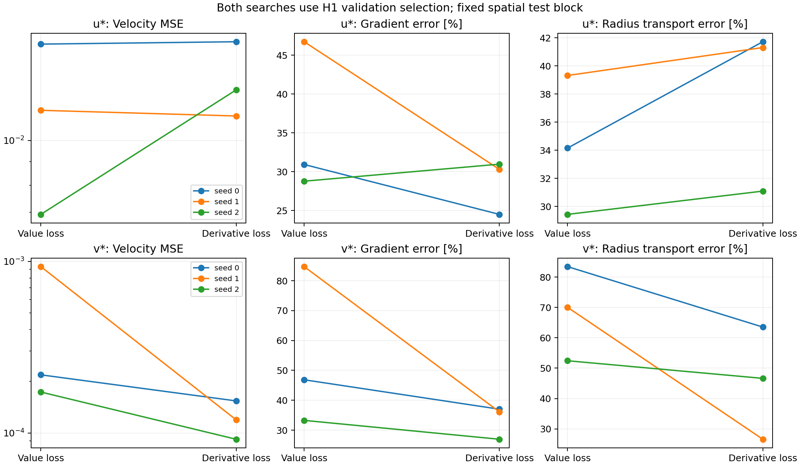
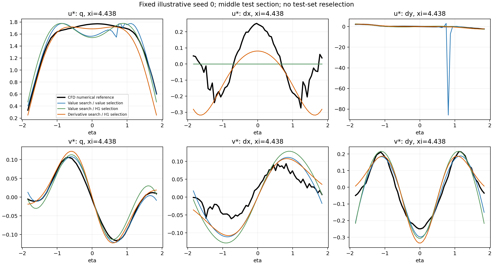

# 真实尾流导数感知符号回归试验（2026-09-28）

**导数感知训练改善了部分空间导数，但没有一致改善所有导数或半径输运项。** 在两组都采用同一 H1 验证选式准则时，u、v 的测试梯度相对 L2 误差均值分别下降 **19.4% / 39.3%**；然而 u 的下游方向导数变差，半径坐标输运项误差增加 **10.9%**。这轮不能作为“整体灵敏度精度已提高”的证据。

本次完成 12 次新 PySR 搜索：真实 CFD 尾流，u/v 两个分量，各 3 个配对种子、两种损失。实验直接拟合速度；没有替换现有流函数主流程，也未实施新的 COMSOL 求解或 PINN 训练。

## 对照协议

数据来自 `outputs_mgn/comsol/eta_sym` 的 `dense_xi_v1`，33×64 网格，ξ∈[3,5]、η∈[−1.9,1.9]，D=0.1 m，速度除以同一 U_in。拟合坐标只做平移 x=ξ−4、y=η，因此解析空间导数无需额外缩放。

使用连续下游区块划分，而非随机逐点划分。原始列分区为：训练 `[0,8), [13,20), [26,33)`，验证 `[8,13)`，测试 `[20,26)`。各块和 η 两端去掉一层，最终训练 992 点、验证 186 点、测试 248 点。测试中心 ξ∈[4.3125,4.5]。三点中心差分标签仅使用所属分区的原始速度值；训练、验证、测试的差分数据支持互不交叠。

对 q∈{u*,v*}，比较

\[
L_\lambda=\frac{\operatorname{MSE}(q)}{\operatorname{Var}_{train}(q)}+
\frac{\lambda}{2}\left[
\frac{\operatorname{MSE}(q_\xi)}{\operatorname{mean}_{train}(q_\xi^2)}+
\frac{\operatorname{MSE}(q_\eta)}{\operatorname{mean}_{train}(q_\eta^2)}\right],
\qquad \lambda=0,1.
\]

PySR 在表达式树上解析计算导数；选式和测试用 SymPy 独立求导。全部尺度仅由训练集计算。每次搜索均为 30 iterations、8 populations、population size 40、150 cycles/iteration、maxsize 25；算子 `+,-,*,/,sin,cos`，Float64，serial/deterministic，种子 0/1/2。相同搜索预算不等于相同耗时，也不意味着已证明搜索收敛。

每组候选都在验证区分别按值误差和 H1 分数选式，先保存固定公式，再评价测试区。没有根据测试误差重选公式、调整 λ 或延长某个种子的预算。

## 三种实际方案的测试表现

下表为三个种子的**相对 L2 误差算术均值**，越低越好。梯度为 `(qξ,qη)` 的合并误差；K_R=−(ξqξ+ηqη)/R，参考由同一数值梯度构造。这里的 K_R 不含入口归一化变化或内在响应 M，不能代替总参数响应。

| 测试量 | 普通 SR＋值选式 | 普通 SR＋H1 选式 | 导数损失 SR＋H1 选式 |
|---|---:|---:|---:|
| u 梯度 | 348.70% | 35.48% | **28.59%** |
| v 梯度 | 42.42% | 54.95% | **33.35%** |
| u 半径输运项 K_R | 168.08% | **34.30%** | 38.04% |
| v 半径输运项 K_R | 61.54% | 68.64% | **45.59%** |

普通 SR 按值选式的 u/seed 0 候选包含剧烈振荡：速度 MSE 仅 0.0104，梯度误差却达 987.39%。改用 H1 选式后，同一次普通搜索的梯度误差降到 30.93%。因此，普通值方案到导数方案的 **91.8% 均值下降受单个异常候选主导**；该直接对照只有 1/3 个 u 种子改善，不能描述为稳定的九成提升。三种子梯度误差中位数实际为 29.93%→30.29%。

v 的普通值方案到导数方案，梯度均值下降 21.4%、K_R 均值下降 25.9%，均为 2/3 个种子改善。H1 验证选式本身也不保证测试区更好；表中普通 SR 的 v 正好体现了这一点。

## 固定选式准则后的训练损失影响

下面两组均按 H1 验证选式，用于进一步区分搜索损失与选式变化。相对误差的单位为百分比，± 为三个种子的样本标准差。最后一列按每个种子的测试误差判断，不做显著性推断。

| 指标 | 普通 SR | 导数损失 SR | 均值相对变化 | 改善种子 |
|---|---:|---:|---:|---:|
| u 速度 MSE | 0.011568 | 0.013505 | +16.7% | 1/3 |
| u 的 ξ 导数 | 84.04±17.59% | 114.05±18.16% | +35.7% | 0/3 |
| u 的 η 导数 | 33.54±11.09% | 23.89±4.18% | −28.8% | 2/3 |
| u 合并梯度 | 35.48±9.81% | 28.59±3.56% | −19.4% | 2/3 |
| u 的 K_R | 34.30±4.95% | 38.04±6.03% | +10.9% | 0/3 |
| v 速度 MSE | 0.000441 | 0.000122 | −72.4% | 3/3 |
| v 的 ξ 导数 | 70.83±29.42% | 59.16±18.94% | −16.5% | 3/3 |
| v 的 η 导数 | 50.24±33.25% | 28.20±8.62% | −43.9% | 3/3 |
| v 合并梯度 | 54.95±26.67% | 33.35±5.56% | −39.3% | 3/3 |
| v 的 K_R | 68.64±15.55% | 45.59±18.49% | −33.6% | 3/3 |

u 的收益主要来自横向 η 导数，下游 ξ 导数反而恶化。合并梯度的相对 L2 由各方向实际幅值加权，而 H1 训练损失按方向分别归一化；两者并非同一个指标。K_R 又包含 ξ、η 的空间权重及带符号组合，因此“合并梯度误差下降”不能直接推出 K_R 更准确。



## 数值参考与实现核查

将测试分区内的速度做 5 点三阶 Savitzky–Golay 平滑后重新计算导数，仅用作参考敏感性诊断。u 的 ξ/η 参考变化约 11.20%/1.59%，v 约 7.66%/2.53%。这表明数值梯度自身仍有不确定性，不能把它当作连续 CFD 真解的精确导数。

在平滑参考下、统一 H1 选式后，u/v 合并梯度均值分别下降 **19.6%/39.5%**，u 的 K_R 仍增加 **11.0%**，v 的 K_R 下降 **34.0%**；改善种子数也不变。因此本轮的主要方向不依赖这两种参考中的某一种。

核查已通过：

- 构造二次多项式的数值导数最大绝对误差 1.28e−13；改变全部验证/测试原始速度，不改变任何训练输入、标签或尺度。
- 含除法和三角函数的 Julia 导数损失与独立解析结果差异 2.78e−17。
- 24 个固定选式记录的 Julia 训练损失，由 SymPy 重算后的最大差异 1.11e−15。
- 输入、代码、分区和固定表达式指纹一致；全部 12 次正式搜索完成。

原始全局 Python 数组访问较慢，试跑在完成 5 次搜索后因性能原因停止；尚未计算测试指标。新实现保持算术和累加顺序，以 Julia 原生向量访问标签。4 条校验表达式的损失逐位相同；重新运行后，5 次已完成旧搜索的两个选式及指标也均完全复现。两次可直接对比的导数搜索由 214.4/233.0 s 降至 47.9/56.5 s。正式新实验共约 364 s 的拟合时间，导数组平均 46.2 s/次、普通组 14.4 s/次，另有初始化和后处理耗时。



## 当前判断及适用范围

导数感知损失值得保留为一个候选训练策略：v 在统一选式准则后表现较一致，u 可以避免仅值选式出现的导数失控。但是当前预算与 λ=1 配置没有解决 u 的 ξ 导数，且其 K_R 在统一 H1 对照下三个种子全部变差。

如果下一步以半径坐标输运项为主要目标，更直接的待验证方案是把 K_R 算子误差纳入损失和验证选式，同时保留速度拟合约束；本次没有运行该方案。不能根据现有测试块反复调权重后继续把该块称作独立测试。

本结论仅针对同一 CFD 快照中的空间留块试验、直接 u/v 表示和当前搜索预算。没有流函数无散硬约束，没有跨几何测试，没有参数响应标签的收敛认证，也没有证明总参数响应 T=K+M 的误差降低。

## 代码、产物与复现

- [训练脚本](../experiments/wake_derivative_aware_sr.py)、[Julia 导数损失](../experiments/wake_derivative_loss.jl)、[核查与绘图脚本](../experiments/audit_wake_derivative_sr.py)。
- [固定协议与数据指纹](../outputs/wake_derivative_aware_sr_2026-09-28_typed/protocol.json)、[全部测试指标](../outputs/wake_derivative_aware_sr_2026-09-28_typed/test_metrics.csv)、[对照汇总](../outputs/wake_derivative_aware_sr_2026-09-28_typed/comparison_overview.csv)、[程序核查](../outputs/wake_derivative_aware_sr_2026-09-28_typed/verification.json)。
- 每个 `u/v_seed*_lambda*/selection.json` 保存两个验证选式的完整公式及指纹；`equations.csv` 保存搜索候选。最初性能试跑另存于 `outputs/wake_derivative_aware_sr_2026-09-28`，有停止原因和源代码快照，不纳入正式测试统计。

```powershell
.\scripts\Invoke-DeeplearningPython.ps1 -ScriptPath .\experiments\wake_derivative_aware_sr.py
.\scripts\Invoke-DeeplearningPython.ps1 -ScriptPath .\experiments\audit_wake_derivative_sr.py
```

正式环境为 Python 3.8.20、PySR 1.5.9；其他包版本、全部配置与代码指纹保存在协议文件。复现相同目录时已完成搜索可复用；更改数据、代码或预算需指定新的 `--out-dir`。
