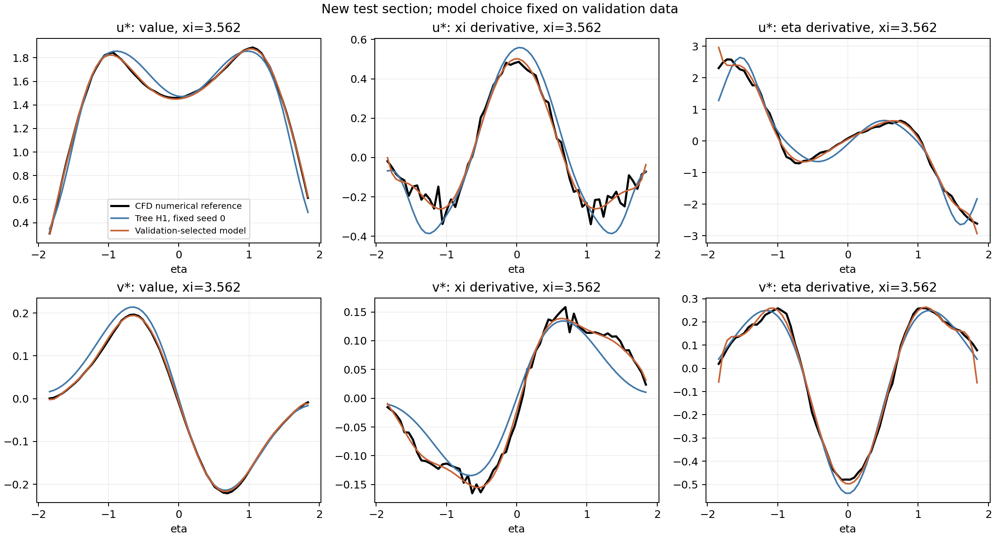

# 导数回归方法优化：算子损失与稀疏结构（2026-09-28）

**本轮找到了明显更好的速度及导数代理，但主要收益来自结构化稀疏表示，而非单独增加半径输运损失。** 按验证集预先选出的模型，在本轮测试块上将 u/v 的下游 ξ 导数误差从 68.11%/34.91% 降至 **15.00%/7.75%**，半径坐标输运项误差从 30.82%/27.01% 降至 **8.83%/9.39%**。

对照是**在本轮相同数据划分上重新训练**的 H1-PySR，表中基线取 3 个搜索种子的均值；推荐的稀疏模型为确定性结果，没有复制成三次训练。不能把这里的绝对误差直接与上一轮不同测试块的数字作前后比较。

## 1. 实际改了什么

上一轮的自由表达式经常忽略 ξ，而包含复杂变量分母的公式还可能出现导数振荡。本轮完成了三层改进：

1. **目标对齐**：在值误差和方向归一化 H1 损失上，加入真正使用的半径坐标输运算子 `K_R=−(ξqξ+ηqη)/R`。所有方法都另存值/H1/算子三种验证选式，主表统一采用算子选式。
2. **结构与系数求解**：增加受限字典的稀疏符号回归，本质为稀疏 Chebyshev 多项式回归。限制 ξ 为低阶，将横向轮廓交给 η 多项式；前向最小二乘选项，联合求解线性系数，并做列缩放和微小岭正则。值、H1、算子三种训练损失使用完全相同的字典和项数预算。
3. **等价计算简化**：对验证选中的多项式作 Horner 代数整理，保持已拟合系数及函数不变，将 u/v 的 SymPy 运算数从 198/224 降至 **56/64**。

稀疏表示为

\[
q(\xi,\eta)=\sum_{(i,j)\in S}a_{ij}T_i(\xi-4)T_j(\eta/1.9),\qquad |S|\leq24.
\]

验证候选取 ξ 阶数 1/2/3、η 阶数 6/8/10/12，项数 8/12/16/20/24。推荐模型最终都是 **24 项、ξ 二阶**，u 的 η 阶数为 10，v 为 12。原始系数与 Horner 公式均已保存。该表示没有变量分母，消除了分母奇点这一类失稳来源；这并不等于任意区域都能准确外推。

## 2. 新一轮验证协议

仍使用 `dense_xi_v1` 的同一历史 CFD 场，33×64 网格，ξ∈[3,5]、η∈[−1.9,1.9]，D=0.1 m。新原始列分区为：

- 训练：`[0,6), [12,21), [27,33)`；
- 验证：`[21,27)`；
- 测试：`[6,12)`。

区间左闭右开，各块及 η 端部各去掉一层，得到 **930/248/248** 个训练/验证/测试点；测试中心 ξ∈[3.4375,3.625]。数值差分模板在各自分区内取值，不跨分区。归一化尺度只取训练集。

与上一轮相比，本轮改变了测试区域并重新训练全部基线，但这仍是**此前已经研究过的同一 CFD 场上的空间留出试验**，不是全新 CFD 算例的盲测。

令

\[
L_q=\operatorname{MSE}(q)/\operatorname{Var}_{train}(q),\quad
L_g=\tfrac12\left[\operatorname{MSE}(q_\xi)/\langle q_\xi^2\rangle_{train}
+\operatorname{MSE}(q_\eta)/\langle q_\eta^2\rangle_{train}\right],
\]
\[
L_K=\operatorname{MSE}(K_R)/\langle K_R^2\rangle_{train}.
\]

自由树对照为 `L_q+L_g` 与 `L_q+L_g+L_K`，每个分量 3 个配对种子，共 **12 次 PySR 搜索**。均为 30 iterations、8 populations、population size 40、150 cycles/iteration、maxsize 25、Float64、serial/deterministic，同样的 `+,-,*,/,sin,cos` 算子。

稀疏字典另外完成 u/v×值/H1/算子，共 **6 组确定性拟合**。主选式分数统一为验证区 `L_q+L_g+L_K`。全部公式、字典阶数、项数以及跨方法的最终推荐模型均先固定，再计算测试指标。较小项数的候选也在测试前另外固定，未按测试误差重选。

## 3. 推荐模型的测试结果

以下为数值 CFD 差分参考下的相对 L2 误差；速度行使用 MSE。推荐模型由**跨全部方法的验证算子分数最小值**选出，u/v 都来自 `sparse_value`，即值损失训练、导数及算子感知选式。

| 指标 | 重训 H1-PySR 基线 | 验证选出的稀疏模型 | 误差降幅 |
|---|---:|---:|---:|
| u 速度 MSE | 7.0125e−3 | **9.4667e−5** | 98.65% |
| v 速度 MSE | 3.2714e−4 | **6.1430e−6** | 98.12% |
| u 的 ξ 导数 | 68.11% | **15.00%** | 77.98% |
| v 的 ξ 导数 | 34.91% | **7.75%** | 77.80% |
| u 合并梯度 | 25.86% | **10.27%** | 60.29% |
| v 合并梯度 | 22.96% | **9.65%** | 57.98% |
| u 的 K_R | 30.82% | **8.83%** | 71.34% |
| v 的 K_R | 27.01% | **9.39%** | 65.24% |

推荐模型的速度相对 L2 误差为 u=0.638%、v=1.852%。收益同时覆盖值拟合、弱 ξ 方向和输运项，没有出现上一轮 u 值误差增加、K_R 同时恶化的组合。

换成分区内 5 点三阶 Savitzky–Golay 平滑后的导数参考，推荐模型 u/v 的 ξ 导数误差为 **9.07%/5.49%**，K_R 为 **7.69%/8.42%**。参考变化说明原始数值梯度仍含明显细尺度成分；不能将当前误差全部归因于模型，亦不能把平滑参考视作精确真值。



## 4. 消融：直接增加 K_R 损失没有解决自由搜索的问题

所有行都使用相同的验证算子选式。PySR 行为 3 种子均值，稀疏行为一次确定性结果。

| 分量 | 方法 | 速度 MSE | ξ 导数误差 | 合并梯度误差 | K_R 误差 |
|---|---|---:|---:|---:|---:|
| u | 自由树 H1 | 0.007013 | 68.11% | 25.86% | 30.82% |
| u | 自由树 H1＋K | 0.042687 | 98.73% | 43.70% | 44.36% |
| u | 稀疏值损失 | 0.0000947 | 15.00% | 10.27% | 8.83% |
| u | 稀疏 H1 | 0.0002066 | 15.87% | 8.01% | 6.47% |
| u | 稀疏 H1＋K | 0.0002914 | 15.64% | 8.76% | 6.14% |
| v | 自由树 H1 | 0.0003271 | 34.91% | 22.96% | 27.01% |
| v | 自由树 H1＋K | 0.0003329 | 42.47% | 27.31% | 29.27% |
| v | 稀疏值损失 | 0.00000614 | 7.75% | 9.65% | 9.39% |
| v | 稀疏 H1 | 0.00000737 | 9.43% | 7.38% | 6.76% |
| v | 稀疏 H1＋K | 0.00000709 | 10.53% | 7.69% | 7.06% |

固定原搜索预算时，给自由树增加 K_R 损失没有获得稳定收益；u 的三个种子 K_R 均变差，部分公式仍忽略 ξ。**仅调整损失无法保证搜索发现合适结构。**

在稀疏字典内部，导数训练对本测试区的 η 导数和 K_R 有额外帮助，但不是所有方向都受益。例如 u 的 K_R 为 8.83%→6.47%→6.14%，伴随速度 MSE 增加。验证区却偏好值损失模型，所以本轮保留该预先固定的推荐，**没有看完测试后改报误差更低的另一行作为推荐结果**。

总体上，结构、可用系数数目与求解器改变的收益大于本轮新增 K 损失的收益。该结论支持当前组合方案的实用性，不证明某一种损失在所有表达式族中都优越。


## 5. 公式规模与核查

24 个稀疏系数不是 PySR 的 25 个树节点，二者不能当作相同复杂度。Horner 后的 56/64 次 SymPy 运算也不是 PySR 节点复杂度。准确度提升包含更丰富表示能力的贡献。

预先固定的较小项数候选在测试区的 K_R 误差如下；各项数内的阶数只用验证集选取：

| 项数上限 | u 的 K_R | v 的 K_R |
|---:|---:|---:|
| 8 | 11.02% | 53.45% |
| 12 | 13.50% | 20.14% |
| 16 | 11.26% | 17.50% |
| 20 | 10.82% | 9.92% |
| 24 | 8.83% | 9.39% |

u 的 8 项模型已有较好 K_R，但 v 的 8 项模型不足；复杂度增加也不保证测试误差逐项单调下降。当前推荐仍按既定验证规则保留 24 项。

核查结果：

- 分区差分支持互不交叠；改变全部留出原始速度，不改变训练输入或标签。
- Chebyshev 数值基与独立 SymPy 值/导数的最大差异 2.00e−15；构造二次多项式的算子拟合相对误差 1.02e−8（含微小正则）。
- 新 Julia 算子损失与独立 Python 计算一致，构造样例差异为 0。
- 全部 **54 个固定选式**的训练损失重算最大差异 6.11e−16；输入、源码、分区和表达式指纹通过检查。
- 在 97×193 密集坐标上，Horner 整理前后的值和一阶导数最大差异：u=2.84e−14、v=1.36e−14。

新 PySR 搜索累计拟合约 512 s，6 组稀疏候选拟合和验证选式累计约 1.36 s，均不含公共导入、Julia 初始化和完整后处理。两者候选空间不同，不能据此视作同一搜索任务的纯加速比。

两个速度分量仍是独立拟合，没有施加流函数无散硬约束。测试区模型散度 RMS 为 0.0157，数值差分参考为 0.0348；较小散度不单独证明物理精度，也不将硬约束状态改成“已满足”。

## 6. 可用产物与范围

推荐使用已核查的 [Horner 公式包](../outputs/wake_operator_aware_sr_v2/compact_velocity_models.json)。其中保存两个分量的完整表达式、原始稀疏系数、规范化、验证选择依据与表达式指纹。表达式变量是 **x=ξ−4、y=η**，不是物理坐标 x/y。原始选择记录另存于 [selected_velocity_models.json](../outputs/wake_operator_aware_sr_v2/selected_velocity_models.json)。

该代理只在既有尾流窗口与当前基准 CFD 场上得到验证。它提高的是速度空间导数及坐标输运项 K_R；没有识别内在响应 M，没有证明总参数响应 T=K+M 的精度，也没有开展跨几何或新 CFD 算例测试。

- [训练与选式脚本](../experiments/wake_operator_aware_sr.py)、[Julia 算子损失](../experiments/wake_operator_loss.jl)、[复核与简化脚本](../experiments/audit_wake_operator_sr.py)。
- [协议与指纹](../outputs/wake_operator_aware_sr_v2/protocol.json)、[全部测试指标](../outputs/wake_operator_aware_sr_v2/test_metrics.csv)、[推荐模型测试指标](../outputs/wake_operator_aware_sr_v2/recommended_test_metrics.csv)、[紧凑模型测试表](../outputs/wake_operator_aware_sr_v2/compact_test_metrics.csv)。
- [训练损失核查](../outputs/wake_operator_aware_sr_v2/verification.json)、[额外核查及公式简化误差](../outputs/wake_operator_aware_sr_v2/additional_verification.json)。

```powershell
.\scripts\Invoke-DeeplearningPython.ps1 -ScriptPath .\experiments\wake_operator_aware_sr.py --sparse-only
.\scripts\Invoke-DeeplearningPython.ps1 -ScriptPath .\experiments\audit_wake_operator_sr.py --freeze-compact-only
.\scripts\Invoke-DeeplearningPython.ps1 -ScriptPath .\experiments\wake_operator_aware_sr.py
.\scripts\Invoke-DeeplearningPython.ps1 -ScriptPath .\experiments\audit_wake_operator_sr.py
```

默认输出为 `outputs/wake_operator_aware_sr_v2`；复用已有完成结果时不会重新搜索。修改源码、数据或设置需对两个脚本指定一致的新 `--out-dir`。
