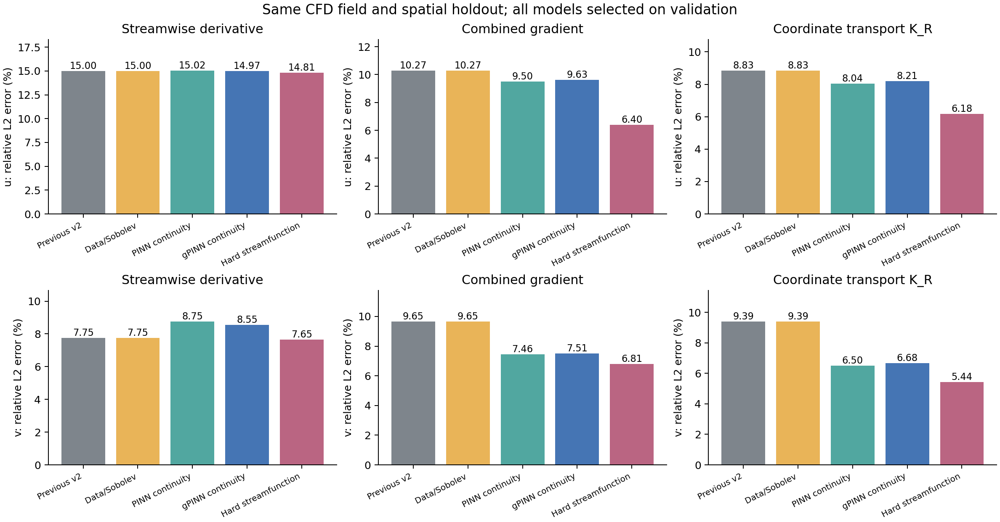
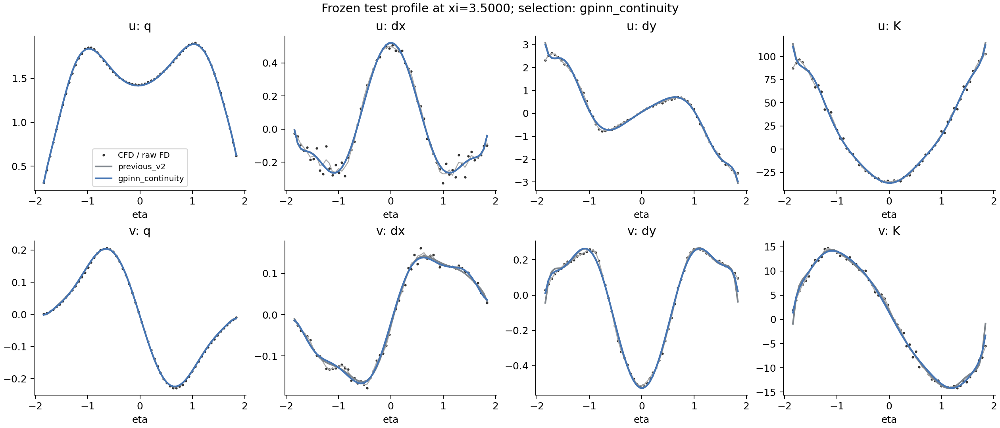

# 借鉴 PINN 的导数感知符号回归：连续性、残差梯度与流函数

日期：2026-09-29。数据：COMSOL 时均尾流 `dense_xi_v1`。本轮是在此前研究过的同一 CFD 场上继续开发，复用 v2 空间分区做配对比较，不是新 CFD 算例的独立验证。

**连续性约束能进一步改善合并梯度和坐标输运项，但收益并不覆盖每个导数方向。** 按验证集预先选出的模型采用较弱的连续性及连续性梯度损失，仍为 u/v 各 24 个系数。相对上一轮推荐模型，测试区 u/v 合并梯度误差从 **10.27% / 9.65% 降至 9.63% / 7.51%**，坐标输运项误差从 **8.83% / 9.39% 降至 8.21% / 6.68%**。v 的流向导数与速度值误差略有增加。

硬流函数在这块测试区更好，合并梯度达到 6.40% / 6.81%，但验证集未选中它。本轮保留原先冻结的推荐，不根据测试结果改选。

## 1. 改进方法及适用物理

上一轮分别拟合 u、v；本轮把二者放入同一个稀疏求解问题，在选择符号项和求解系数时加入它们的物理联系。比较四组方法：

| 方法 | 表示与训练约束 |
|---|---|
| `data_control` | u/v 联合稀疏选择；值损失及可选 H1 损失；不加物理残差 |
| `pinn_continuity` | 在直接速度表示上加入连续性残差 |
| `gpinn_continuity` | 再加入连续性残差的空间梯度，借鉴 gradient-enhanced PINN |
| `hard_streamfunction` | 拟合一个符号流函数，令 u=ψ_η、v=−ψ_ξ，解析保证无散度 |

这次借鉴的是 PINN 的**物理残差、解析微分、无标签配点和联合训练**，模型仍是稀疏符号多项式，使用 NumPy/SciPy 求解。没有把神经网络当作新的标签来源，也没有进行新的 PySR 自由树搜索。

数据平均区间为时间索引 `[400,801)`，元数据没有提供 Re。对不可压缩流动，时均速度满足连续性；时均动量方程则涉及压力、黏性系数和雷诺应力等信息。因此本轮只加入连续性，没有把当前时均场当作满足未闭合稳态 Navier–Stokes 动量方程的解。

令

\[
r=u_\xi+v_\eta,\qquad
r_\xi=u_{\xi\xi}+v_{\xi\eta},\qquad
r_\eta=u_{\xi\eta}+v_{\eta\eta}.
\]

训练目标为

\[
L=\sum_{q\in\{u,v\}}(L_q+\alpha L_{g,q})
 +\beta\left(L_c+\gamma L_{\nabla c}\right),
\]

\[
L_q=\frac{\operatorname{MSE}(\widehat q-q)}{\operatorname{Var}_{train}(q)},\qquad
L_{g,q}=\frac12\left[
\frac{\operatorname{MSE}(\widehat q_\xi-q_\xi)}{\langle q_\xi^2\rangle_{train}}
+\frac{\operatorname{MSE}(\widehat q_\eta-q_\eta)}{\langle q_\eta^2\rangle_{train}}\right],
\]

\[
s_c=\langle u_\xi^2\rangle_{train}+\langle v_\eta^2\rangle_{train},\quad
L_c=\frac{\langle r^2\rangle_\Omega}{s_c},\quad
L_{\nabla c}=\frac{\langle r_\xi^2+(1.9r_\eta)^2\rangle_\Omega}{2s_c}.
\]

这里 Ω 为 ξ∈[3,5]、η∈[−1.9,1.9] 的完整尾流矩形，括号表示面积平均。梯度长度尺度采用坐标归一化中的 1 和 1.9。384 个 Gauss 配点不使用 CFD 标签，覆盖整个已知窗口，也包括留出区的坐标；它们不是额外的速度观测。16×24 的积分阶数足以精确积分本轮多项式残差的平方，另用更高阶积分复核。

所有符号导数直接由 Chebyshev 基解析求得。数值差分仅用于 CFD 导数监督和评价，不用于对预测模型求导。

## 2. 比较协议与验证选择

原始 ξ 列分区复用 v2：训练 `[0,6), [12,21), [27,33)`，验证 `[21,27)`，测试 `[6,12)`，区间右端不包含。各块两端及 η 两端各去一层，得到 **930 / 248 / 248** 个训练、验证、测试点；测试中心 ξ∈[3.4375,3.625]。差分和平滑支持留在各自分区，尺度全部由训练集计算。

直接速度模型使用

\[
q=\sum a_{ij}T_i(\xi-4)T_j(\eta/1.9).
\]

共同候选阶数为 ξ 的 1/2/3 阶与 η 的 6/8/10/12 阶，另纳入上一轮已验证的 u=(2,10)、v=(2,12) 字典。流函数项按两个速度分量的阶数限制求交集，确保微分后的 u/v 落在与直接模型相同的速度多项式空间范围内；去掉不可辨识的 ψ 常数项。

总系数预算为 **16/24/32/40/48**；直接模型额外限制每个速度分量最多 24 项。相同系数上限不代表完全相同的函数类或运算复杂度，流函数的一个系数可以同时影响两个速度分量。

参数候选：α∈{0,0.1,1}，β∈{0.01,0.1,1,10}，γ∈{0.01,0.1,1}。无物理对照取 β=0，普通连续性取 γ=0。求解使用标准化列上的前向最小二乘稀疏选择及 1e−8 微小 ridge。

完成 **702 条确定性稀疏拟合路径、3288 个新候选**，另重新拟合上一轮推荐模型，系数复现误差为 0。候选数分别为：数据对照 186、普通连续性 744、梯度增强连续性 2232、硬流函数 126。它们的超参数空间大小不同，不作为相同搜索次数的比较。

主选式分数沿用导数与输运感知评价：

\[
S_{val}=\sum_{q\in\{u,v\}}(L_{q,val}+L_{g,q,val}+L_{K,q,val}),
\quad L_{K,q}=\frac{\operatorname{MSE}(\widehat K_R-K_R)}{\langle K_R^2\rangle_{train}},
\quad K_R(q)=-\frac{\xi q_\xi+\eta q_\eta}{R}.
\]

选式不包含散度惩罚，以避免仅靠减小散度赢得比较。所有方法、系数预算内的紧凑候选及固定项消融均在首次本轮测试评估前写入 `frozen_selection.json`。本轮没有改变已公开的旧测试分区，因此结果仍属于同一历史算例上的持续开发。

| 方法 | u/v 速度阶数范围 | α | β | γ | 系数总数 | 验证分数 |
|---|---|---:|---:|---:|---:|---:|
| 上一轮 / 新数据对照 | (2,10) / (2,12) | 0 | 0 | 0 | 48 | 0.01873125 |
| 普通连续性 | (2,10) / (2,12) | 0 | 0.1 | 0 | 48 | 0.01892888 |
| **梯度增强连续性：推荐** | **(2,10) / (2,12)** | **0** | **0.01** | **0.01** | **48** | **0.01841719** |
| 硬流函数 | (3,12) / (3,12) | 0.1 | 硬约束 | — | 48 | 0.01935515 |

推荐模型的有效连续性梯度系数 βγ=1e−4，验证分数改善 **1.68%**。它没有直接使用数值导数作为训练标签（α=0），导数信息来自物理残差、残差梯度和验证选式。这不支持“增大带噪导数监督权重总会更好”的结论。

## 3. 冻结后的测试结果

表内均为相对 L2 误差，百分数；速度值的 MSE 另列于完整指标文件。

| 方法 | u_ξ | u 合并梯度 | u 的 K_R | v_ξ | v 合并梯度 | v 的 K_R |
|---|---:|---:|---:|---:|---:|---:|
| 上一轮推荐 / 新数据对照 | 15.00% | 10.27% | 8.83% | 7.75% | 9.65% | 9.39% |
| 普通连续性 | 15.02% | 9.50% | 8.04% | 8.75% | 7.46% | 6.50% |
| **梯度增强连续性：推荐** | **14.97%** | **9.63%** | **8.21%** | **8.55%** | **7.51%** | **6.68%** |
| 硬流函数：冻结的比较候选 | 14.81% | 6.40% | 6.18% | 7.65% | 6.81% | 5.44% |

推荐模型 u/v 合并梯度误差分别降低 **6.23% / 22.13%**，K_R 误差分别降低 **7.09% / 28.83%**；u/v 合计的归一化值、导数、输运分数从 0.05574 降至 0.04524，降低 18.84%。

代价是 v_ξ 误差从 7.75% 增至 8.55%；u/v 速度相对 L2 从 0.638% / 1.852% 增至 0.651% / 1.937%。对应速度 MSE 从 9.4667e−5 / 6.1430e−6 增至 9.8649e−5 / 6.7201e−6。改进主要在横向导数和其参与的输运项，流向导数问题仍未完全解决。

测试散度 RMS 从 **0.015725 降至 0.006708**，降低 57.34%；原始 CFD 差分散度 RMS 为 0.034751。散度下降是物理约束生效的证据，不能独立当成全部导数更准确的证明。

使用分区内部 5 点三阶 Savitzky–Golay 平滑后的导数参考，结论基本一致：

| 方法 | u 合并梯度 | u 的 K_R | v 合并梯度 | v 的 K_R |
|---|---:|---:|---:|---:|
| 上一轮推荐 | 9.73% | 7.68% | 9.26% | 8.42% |
| 梯度增强连续性 | 9.05% | 6.95% | 6.96% | 5.23% |
| 硬流函数 | 5.50% | 4.36% | 6.20% | 3.54% |

平滑参考仍是近似参考，不是精确导数真值。u_ξ 的误差对原始/平滑参考明显敏感。





## 4. 消融揭示的收益与限制

固定推荐模型已经选中的符号项和导数权重，去掉物理损失重新求系数。该消融也在测试前冻结。与原模型相比，u 的项集合不变，v 有两项替换，因此可以区分项的选择与物理约束对系数的作用。

| 模型 | u 合并梯度 | u 的 K_R | v 合并梯度 | v 的 K_R |
|---|---:|---:|---:|---:|
| 上一轮项集合及系数 | 10.27% | 8.83% | 9.65% | 9.39% |
| 推荐项集合，去掉物理损失重新拟合 | 10.27% | 8.83% | 8.20% | 7.81% |
| 推荐项集合，保留物理损失 | 9.63% | 8.21% | 7.51% | 6.68% |

这说明改进来自两部分：物理目标影响稀疏项的选择，之后也改善同一组项的系数。不能把全部收益归因于单纯的参数微调。

**本轮没有证明残差梯度损失一定优于普通连续性。** gPINN 式候选在验证区略胜，普通连续性候选在这块测试区的合并梯度和 K_R 略好。二者在候选权重和稀疏选择上也有差别。当前证据较明确地支持“联合物理约束有帮助”，对“必须加入残差梯度”的支持较弱。

硬流函数在测试区的值、合并梯度和 K_R 更好，并解析满足连续性；这使它成为值得继续验证的候选。但其速度阶数选到了 ξ 三阶，且训练用了 α=0.1 的 H1 权重，不能把全部差异归因于无散度表示。它在验证分数上仍落后于推荐模型，不能依据这次测试结果直接换成新的推荐。

较小预算候选也全部在测试前冻结。例如 32 个流函数系数的测试 K_R 为 u=6.93%、v=7.03%，显示共享表示有压缩潜力；但各预算与方法的误差不单调，完整结果见 `compact_test_metrics.csv`。这些观察需要用预先固定的多空间块验证或新 CFD 场验证，不能反过来重选本轮已报告的测试结果。

## 5. 核查与可用产物

已完成的数值与审计核查：

- 修改所有验证/测试原始标签后，全部训练数组保持不变；分区差分支持互不交叉。
- 用构造流函数检验速度及其一、二阶解析导数，包含流函数三阶导数；制造解拟合相对误差 1.39e−15。
- 加密积分点后，物理残差 Gram 矩阵的最大相对变化 2.22e−13。
- 全部 3289 个候选的系数上限、每个方法及每个预算的验证选择通过检查。
- 23 个不同的冻结模型经独立 SymPy 审计：值及一、二阶导数最大差异 1.36e−13；训练目标重算最大差异 3.89e−14；验证分数最大差异 5.07e−16。
- 所选系数满足带微小 ridge 的正规方程，最大相对残差 2.16e−15。
- 推荐模型在 97×193 网格上的 Horner 导出值及一、二阶导数最大差异 8.53e−14；测试指标独立重算最大差异 1.18e−12。
- 硬流函数在解析表示下连续性恒成立；独立展开的浮点表达式允许舍入误差，另以相同十进制系数的有理数表示核对恒等式。

候选拟合、选择与冻结记录耗时约 6.37 秒，不含通用检查、独立审计与绘图。这是固定字典上的稀疏线性求解，不能当作同一搜索任务对 PySR 的加速比。

推荐 [模型包](../outputs/wake_pinn_informed_sr_v3/selected_velocity_models.json) 保存 u/v 的 Horner 公式、48 个非零系数、字典阶数、损失权重及指纹；两分量运算数分别为 56/58。公式变量是 **x=ξ−4、y=η**，速度已除以 U_in。硬流函数候选及其 ψ 公式保存在 [全部候选方法公式](../outputs/wake_pinn_informed_sr_v3/finalist_formulas.json)。

这些模型验证的是既有尾流窗口中的速度空间导数与坐标输运项 K_R，尚未识别内禀响应 M，不能据此声称总参数响应 T=K+M 已改善，也不能据此声称跨几何、跨 Re 的泛化精度。

- [拟合脚本](../experiments/wake_pinn_informed_sr.py)、[独立复核脚本](../experiments/audit_wake_pinn_sr.py)。
- [协议与数据/源代码指纹](../outputs/wake_pinn_informed_sr_v3/protocol.json)、[验证冻结记录](../outputs/wake_pinn_informed_sr_v3/frozen_selection.json)、[验证候选表](../outputs/wake_pinn_informed_sr_v3/validation_candidates.csv)。
- [完整测试指标](../outputs/wake_pinn_informed_sr_v3/test_metrics.csv)、[推荐模型测试指标](../outputs/wake_pinn_informed_sr_v3/recommended_test_metrics.csv)、[各预算测试指标](../outputs/wake_pinn_informed_sr_v3/compact_test_metrics.csv)。
- [首次测试前的复核](../outputs/wake_pinn_informed_sr_v3/pre_test_verification.json)、[最终复核](../outputs/wake_pinn_informed_sr_v3/verification.json)、[训练损失分项审计](../outputs/wake_pinn_informed_sr_v3/training_loss_audit.csv)。

复现命令（在仓库根目录运行；无需 Julia）：

```powershell
$env:OPENBLAS_NUM_THREADS='1'
$env:OMP_NUM_THREADS='1'
$env:MKL_NUM_THREADS='1'
& 'D:\keyan\Anaconda\envs\deeplearning\python.exe' experiments/wake_pinn_informed_sr.py --fit-only
& 'D:\keyan\Anaconda\envs\deeplearning\python.exe' experiments/audit_wake_pinn_sr.py --pre-test
& 'D:\keyan\Anaconda\envs\deeplearning\python.exe' experiments/wake_pinn_informed_sr.py --evaluate-only
& 'D:\keyan\Anaconda\envs\deeplearning\python.exe' experiments/audit_wake_pinn_sr.py
```

默认结果目录为 `outputs/wake_pinn_informed_sr_v3/`。协议和源代码未改变时可复用冻结结果；改变数据、源代码或配置后须指定新的 `--out-dir`。旧实验及现有主流水线模型均保留。
