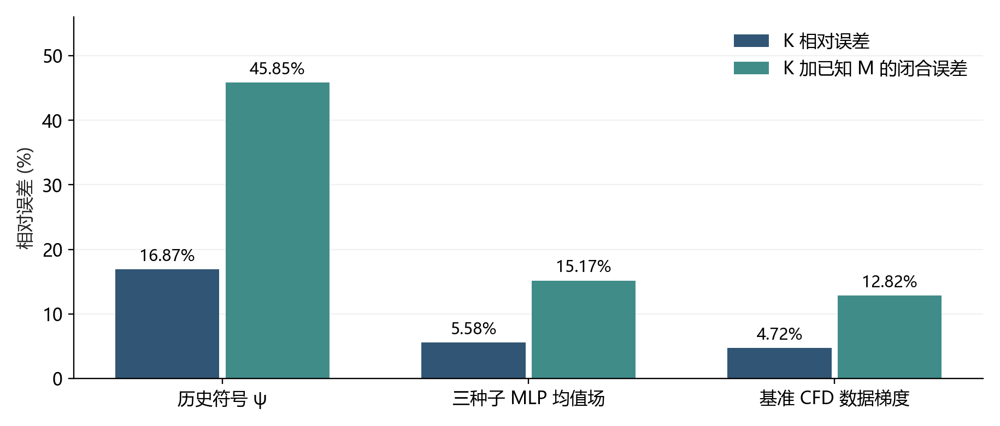
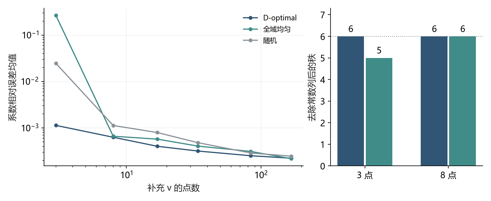
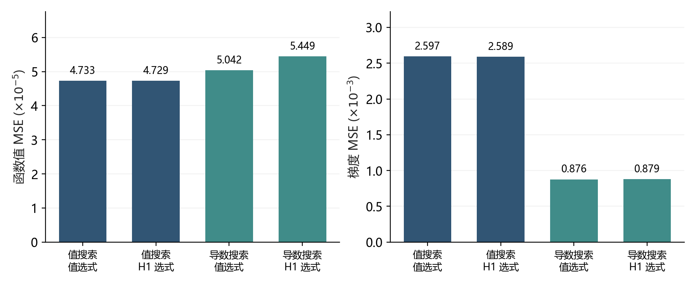
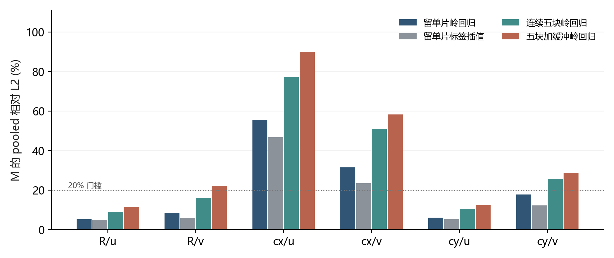
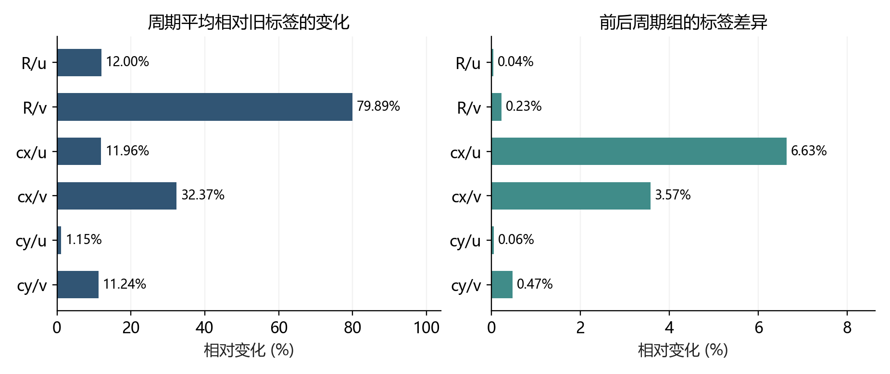
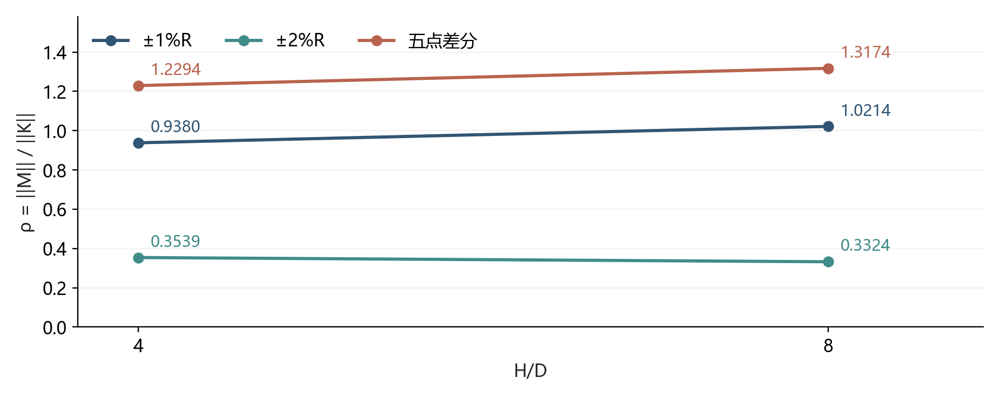

# 圆柱绕流符号建模与灵敏度研究成果汇总报告

截至 2026 年 9 月 20 日

## 摘要

本项目围绕二维圆柱尾流，研究能否通过物理约束符号回归，从基准流场获得可解释表达式，并进一步预测半径和圆心位置变化引起的流动响应。现阶段已经完成 COMSOL 数据预处理、速度与流函数建模、几何响应分解、符号模型与神经网络梯度对照，以及观测可辨识性、导数损失、局部响应重建和标签可靠性等实验。

**最主要的成果，是建立了从流场拟合到参数响应评价的研究框架，并识别出决定响应预测是否可信的三个条件：观测必须提供目标所需的信息，模型必须准确表示相关导数，有限差分参照必须具有稳定的统计与离散化定义。** 这些条件分别得到 P1、P2 与真实尾流审计的支持。

已有结果尚未证明“仅凭单次基准仿真的被动后处理，就能准确恢复全部几何参数总响应”。坐标输运项 K 可以由基准空间梯度和几何映射计算，但内在响应 M 还需要参数方向的信息。当前半径响应流函数在统一的有限差分目标上，完整无量纲总响应相对误差为 u 分量 82.92%、v 分量 155.71%；周期平均审计又显示，部分旧响应标签显著依赖平均窗口。因此，当前成果应定位为可解释响应建模的原型、机制诊断和可复核证据基础。[E1–E4]

| 成果模块 | 代表性结果 | 当前证据范围 |
|---|---|---|
| 响应分解与实现 | 六条解析链式关系成立；离散路径闭合约 1.70×10⁻¹⁶ | 公式与记账验证 |
| 微分观测可辨识性 | 七项字典秩从 3 提升至 6，仅剩常数规范 | 指定字典和观测域 |
| 导数损失探索 | 历史两组候选在新增测试点的梯度 MSE 差异约 66.17% | 尚缺配对多种子因果验证 |
| 基准代理梯度 | R/u 的 K 误差为符号模型 16.87%、MLP 均值场 5.58% | 当前存档与同一 FD 目标 |
| 局部 M 重建 | 原留单片 R/u、R/v 为 5.15%、8.49%；cx 明显失败 | 同算例空间标签预测 |
| 标签可靠性 | 周期平均相对旧标签改变 R/v 79.89%、cx/v 32.37% | 平均协议敏感性诊断 |
| 通道约束比研究 | 差分步长变化使 H/D 趋势翻转 | 当前无可靠物理结论 |
| 参数重要性排序 | 同一全域指标下 T、数据 K、符号 K 均给出 R > cy > cx | 单工况探索性排序 |
| 工程流程 | 数据指纹、运行隔离、固定选式和合成文件链测试已实现 | 真实 CFD 全链重训尚未完成 |

关键词：圆柱尾流；物理约束符号回归；流函数；参数灵敏度；微分观测；导数学习；周期平均。

## 1 研究问题与成果范围

### 1.1 从速度表达式到参数响应

研究最初从“用简单公式拟合单次圆柱流场”出发，逐步转向更严格的问题：拟合得到的公式，其空间导数是否可靠；空间导数能解释多少几何参数响应；剩余响应需要什么额外信息。二者之间存在明确的任务差异。一个表达式可以很好地拟合速度，却给出较差的梯度；一个无散度代理也可能无法预测参数变化后的流动。

本报告把成果按实际验证层次组织。P0 检查响应分解与记账；P1 检查部分微分观测的信息缺失；P2 检查函数值与导数目标的错配；ψ 和 MLP 比较基准代理的空间梯度；φ 与 A0 分别探索响应的符号表达和局部特征重建；P3 检查不同通道约束比下的半径响应；2026 年 9 月的两轮审计进一步检查结论、标签与评价协议。[E1–E3]

### 1.2 单次仿真的信息口径

“一次仿真”需要区分三种信息条件。D0 指一次基准轨迹的被动后处理；D1 指一次非线性基准求解加辅助切线或伴随求解；D2 指包含参数扰动的多算例数据。当前 φ 和 A0 的训练标签来自扰动算例，属于使用了 D2 信息的监督重建。未来可以研究离线多算例训练、在线只输入一个新基准场的模型，但必须另行验证跨算例推广并计入离线成本。

P1 中补充 v 观测解决的是流函数的部分空间信息缺失；完整几何响应缺少的是参数方向信息。恢复 ψ 并不自动恢复 M。这一区分也是后续面向人工智能方法研究的基础。

## 2 数据基础与实验资产

### 2.1 基准和几何扰动数据

主数据由一组基准和 R、cx、cy 三个方向的六组正负扰动组成，原始文本约 5.35 GB。每组包含 0–8 s 的 801 帧，导出间隔为 0.01 s。旧流程使用索引 400 至 800，即 4.00–8.00 s 的 401 帧等权平均。2026 年 9 月 9 日已从原始时序重新计算，六项 M 与旧存档最大相对差约 1.70×10⁻¹³，确认这些标签可以从原始数据重建。[E3]

| 项目 | 已确认的设置 |
|---|---|
| 基准几何 | D=0.1 m，R=0.05 m，圆心 cx=0.2 m、cy=0.2 m |
| 参数差分步长 | hR=0.001 m，hcx=hcy=0.002 m |
| 基准速度尺度 | 入口附近节点时均 u 的均值 Uin≈0.7299456 m/s |
| 主尾流窗口 | ξ∈[3,5]，η∈[−1.9,1.9] |
| 当前规则网格 | 33×64，共 2112 点；Δξ=0.0625，Δη≈0.0603 |
| 旧符号模型网格 | ψ 和 φ 的历史训练快照为 16×64 |
| 当前 MLP 网格 | 33×64，三个随机种子 |
| 原始物理信息边界 | 基准导出含 6361 个节点；Re 和黏度等信息尚未完整提供 |

R 扰动数据沿入口峰值 Umax·D≈0.15 的控制路径变化。因而现有 R 响应是沿该路径的变化率，不能直接解释为固定入口速度下的纯半径偏导。Umax 与归一化使用的 Uin 含义不同，不能混用。[E1、E3、E5]

### 2.2 通道约束比与结果版本

P3 另有约 12 GB 的 H_D.txt，包含 H/D=4 和 8、每组五个半径档位，共约 4032 万个时空样本。半径为 R=0.05+0.001sR，sR 取 −1、−0.5、0、0.5、1，分别构成 ±1%R 和 ±2%R 差分。[E10]

数据网格更新不等于模型已经重训。当前密集 CFD 评价网格为 33×64，历史符号 ψ/φ 仍来自 16×64 快照。下文真实流场指标优先采用 2026 年 9 月 8 日在统一目标上的重算；P0 的旧网格结果单独注明。周期平均结果目前用于诊断，尚未替换全流程的训练与评价参照。

## 3 方法体系与理论成果

### 3.1 流函数表示与不可压缩结构

定义无量纲坐标 ξ、η，并用流函数表示二维速度：

$$
\xi=\frac{x-c_x}{D},\qquad \eta=\frac{y-c_y}{D},\qquad D=2R.
$$

$$
u^*=\frac{\partial\psi^*}{\partial\eta},\qquad v^*=-\frac{\partial\psi^*}{\partial\xi}.
$$

在函数足够光滑时，两个混合偏导相消，因此模型速度满足解析散度为零。该结构消除了独立拟合 u/v 时的运动学不一致，但没有保证动量方程、速度精度或参数响应精度。训练中的 ψ-A 只约束 u；ψ-B 联合约束 u/v。主 ψ 搜索仍通过规则网格中心差分构造速度损失，后续导出速度与灵敏度使用解析求导；P2 的解析表达式树导数损失是独立实验，尚未完成在主 ψ 训练中的验证。[E1、E5]

### 3.2 几何输运与内在响应的分解

令 q* 表示任一无量纲速度分量，a 表示 R、cx 或 cy。固定物理位置的总响应 T* 可以写为坐标输运 K* 与固定参考坐标内在响应 M* 的和：

$$
T_a^*=K_a^*+M_a^*.
$$

$$
K_R^*=-\frac{2}{D}\left(\xi\partial_\xi q^*+\eta\partial_\eta q^*\right),\quad K_{c_x}^*=-\frac{1}{D}\partial_\xi q^*,\quad K_{c_y}^*=-\frac{1}{D}\partial_\eta q^*.
$$

若速度尺度随参数变化，有量纲响应还包括归一化尺度的导数：

$$
T_a=U_0\left(K_a^*+M_a^*\right)+U'_a q_0^*.
$$

该分解属于坐标链式法则。项目的成果在于把它落实为可计算、可对照的场分解，明确不同模型的误差来源。2026 年 9 月 8 日的构造解验证覆盖 R/cx/cy×u/v 六条关系，解析表达式严格相等；中心差分步长依次减半时误差比在 3.99934–4.00052，符合二阶中心差分。[E1]

### 3.3 单基准信息的边界

构造两族流函数 ψA=ψ0 与 ψB=ψ0+(R−R0)ξη。二者在 R0 上的基准场和所有空间导数完全相同，且都保持无散度结构，但 ψB 多出的半径内在响应为 Mu=ξ、Mv=−η。因此，基准流场与不可压缩约束本身不足以唯一决定参数响应。

这一反例说明运动学信息不足；它没有声称两族函数满足相同参数化 N-S 方程及边界条件。若提供完整 PDE、初边值及其参数依赖，可以通过切线等辅助方程进一步约束响应。目前尚无已经实现并验证的局部切线求解器。[E1、E4]

## 4 基准流场符号建模与梯度比较

### 4.1 从直接速度拟合转向流函数

早期直接 u 拟合包含值拟合 A 与加入连续性残差的 B。保存的 Pareto 候选中，缺少 ξ 依赖的比例分别为 8/9 和 11/12；流函数 u-only 候选为 9/15，联合 u/v 为 5/15。这表明互补观测与模型表示会影响找到的表达式，但候选比例属于当前搜索快照，不是普适概率，也不能证明直接 u 模型中 ξ 缺失只有一个成因。[E6]

另一个已归档分支尝试把数据特征 ∂v/∂y 再用符号代理 g 替换，形成 B+g。归档记录显示，放宽直接 A 的复杂度预算后，A 可达到 MSE≈8.5×10⁻⁴、展开运算数 13，而 B+g 的一个展开表达式达到 41 个运算。这揭示复杂度预算会混淆所谓物理约束优势。该分支还存在同数据拟合评价、扰动重标度未定义等问题，已经退出主线。对应输出目录缺失，旧复杂度口径也不完全统一，数字仅作为历史记录。[E11]

### 4.2 当前基准代理的梯度精度

以统一 33×64 FD 目标的 R/u 响应为例，定义经验输运 Kemp=T−M。K 相对误差以 Kemp 范数为分母，闭合误差以 T 范数为分母。表中“加入已知 M”用于隔离基准模型的 K 误差，不是可部署的完整响应预测。

| 基准梯度来源 | 当前 u 场 MSE | K 相对误差 | K 加已知 M 的总闭合误差 |
|---|---:|---:|---:|
| 历史符号 ψ | 3.952×10⁻³ | 16.87% | 45.85% |
| 三种子 MLP 均值场 | 6.975×10⁻⁶ | 5.58% | 15.17% |
| 基准 CFD 数据梯度 | 不适用 | 4.72% | 12.82% |

MLP 使用 4×64 tanh 网络、float64、λv=1 和 20000 次优化步。三个种子的 K 误差为 5.58%、5.81%、5.54%；均值场指标是先平均预测再计算误差，并非三个误差的简单平均。其训练网格和容量与历史符号模型不同，所以只能确认当前存档上的梯度表示改善，不能据此作公平算法优越性或跨算例推广结论。[E1、E7]

将 MLP 的训练网格由 16×64 加密至 33×64，均值场 K 误差由 5.6946% 降至 5.5848%，仅改善约 0.11 个百分点；同期数据梯度参照由 4.8381% 变为 4.7182%。因此，该加密实验没有显示模型相对数据梯度差距的实质缩小。所谓“数据梯度底线”只是当前离散参照，不是不可突破的真实误差下界。[E7]

### 4.3 保存候选中的值与梯度排序错配

对现有 ψ-A/B 候选回溯评价，记录的 B-E14-C21 的 R/u K 误差为 16.87%；梯度最优的 A-E12-C19 为 14.45%，但原 u-MSE 是前者的 1.85 倍。所有候选的原 u-MSE 与 K 误差 Spearman 相关系数仍为 0.944。由此可见，值误差总体有参考价值，却不足以唯一确定下游梯度最优表达式。

这一回溯同时用同一 FD 目标排序和报告，属于诊断，不是导数选式的独立测试。即使选到保存候选中的最优 K，其加入已知 M 后的闭合误差仍约 39.26%，说明仅改变本批候选的选择还不足以完成响应任务。[E8]

## 5 P0 与半径响应流函数实验

### 5.1 离散路径闭合的意义

P0 对同一组映射前后场构造有限步长的 T、M 和路径输运，最大闭合残差约 1.70×10⁻¹⁶。因为三个量按同一代数关系构造，随机数组也可闭合到 1.36×10⁻¹⁶。它有效检查了符号、坐标和记账，但不能认证 CFD 参数导数准确到机器精度。

旧 16×64 P0 存档中，u 分量基准数据梯度的 R/cx/cy 闭合误差分别为 19.96%、6.16%、10.25%；符号梯度为 37.78%、35.39%、43.59%。这些数字与密集评价网格上的结果有不同网格口径，不能串接成同一次模型改进。2026 年 9 月 8 日从七组节点时均缓存独立重建得到 T/M，与存档最大相对差 3.38×10⁻¹⁴，进一步确认计算实现可复核；参数步长和 CFD 网格收敛仍需新增证据。[E1、E9]

### 5.2 分量抵消放大总响应误差

当前 R/u 经验输运放大系数 κK=‖Kemp‖/‖T‖≈2.7171。平均绝对幅值分别为 T 13.84、M 27.01、Kemp 38.06，单位为无量纲速度对半径的响应单位 m⁻¹。K 与 M 的抵消使总响应对分量误差敏感。使用数据梯度 K 单独替代 T 的相对误差约 231.11%，表明仅计算坐标项远不足以恢复完整响应。[E1]

当 M 已知且保持不变时，闭合误差与 K 误差满足 εclosure=κKεK；这由误差定义直接推出。一般近似模型还满足：

$$
e_T\leq\kappa_K e_K+\kappa_M e_M,\qquad \kappa_K=\frac{\|K\|}{\|T\|},\quad \kappa_M=\frac{\|M\|}{\|T\|}.
$$

该式是三角不等式的误差预算，不是新的理论定理。若 M 完全准确，要以此充分条件保证 T 误差不超过 10%，当前 K 的误差需不超过约 3.68%；同时拟合 M 时预算更严格。实际误差也可能抵消，最后仍须直接评价 T，且近零目标需同时报告绝对误差。[E4]

### 5.3 响应流函数的结果与边界

Step 6 用半径扰动生成的 M 监督响应流函数 φR，再通过其偏导恢复 Mu、Mv。当前目标重算后仍选中历史复杂度 25 的表达式。它的解析散度为零，但误差如下：

| 当前目标上的评价 | u 分量 | v 分量 |
|---|---:|---:|
| 内在响应 M 相对 L2 | 29.46% | 39.81% |
| 完整无量纲符号总响应相对 L2 | 82.92% | 155.71% |
| 严格导出公式的有量纲总响应相对 L2 | 41.84% | 172.95% |

有量纲和无量纲行的目标、分母不同，不应直接用百分比大小判断哪种版本“更准确”。有量纲响应流函数按 φdim=U0φR+U′Rψ0 构造；完整表达式使用 ψ0 的导数，而不能在评价时偷偷替换为 CFD 基准场。此前混合公式与完整符号公式的响应差值 RMS 为 u 0.9166、v 0.5894，现有接口已统一其计算口径。[E1、E5]

本实验实现了从响应标签到闭式表达式的原型，但尚未获得高精度全符号总响应。其训练使用了扰动信息，当前目标还参与重算选式，因此评价属于响应重建，不能表述为未知参数或未知算例上的盲测预测。

## 6 P1 微分观测零空间与互补观测

P1 在 41×41 位置网格上构造七项显式流函数字典，比较只观察 u 与联合观察 u/v 的观测矩阵。u=∂ηψ 无法观测常数及仅依赖 ξ 的项；联合 v=−∂ξψ 可约束这些方向。该实验通过矩阵秩和最小二乘直接验证，不依赖 PySR 能否搜索到某个表达式。[E6]

| 观测条件 | 观测矩阵秩 | 零空间维数 | 无规范列系数恢复误差 |
|---|---:|---:|---:|
| 仅 u | 3/7 | 4 | 约 0.3301 |
| 全域 u 与 v | 6/7 | 1 | 约 3.68×10⁻¹⁵ |

剩余一维对应流函数加常数的规范自由度，不改变速度。对稀疏补充 v 的实验，修正后的均匀方案在每个预算上重新覆盖全域；噪声相对幅度为 0.001，各方案进行 50 次噪声重复。关键预算结果为：

| v 观测点数 | D-optimal 秩 | 均匀秩 | D-optimal 系数误差均值 | 均匀系数误差均值 |
|---|---:|---:|---:|---:|
| 3 | 6 | 5 | 0.001136 | 0.265907 |
| 8 | 6 | 6 | 0.000630 | 0.000663 |

三点时，均匀位置 ξ=−1、0、1 仍使指定字典中的部分列相关，D-optimal 可选择非退化位置。八点时二者都满秩，均值差约 3.27×10⁻⁵，小于该比较的均值差标准误约 6.97×10⁻⁵；当前实验不支持该预算下的显著优势。

因此，P1 支持“互补观测可消除指定字典的不可观测方向，极小预算下位置选择很关键”。它尚未证明未知符号结构下的一般主动学习优势。若一次 CFD 已经输出全场 u/v，事后只取少数 v 点属于缺测学习实验，不能自动折算为节省同等比例的仿真成本。

## 7 P2 函数值与解析导数联合学习

### 7.1 可控任务及历史结果

P2 使用解析目标 f(x,y)=sin(x)cos(y)+0.05sin(6x)，其中低幅高频项在函数值中不突出，在导数中却更重要。一般地，小扰动 εsin(kx) 的值幅度为 ε，导数幅度为 εk，直接解释了低值误差为何不能保证低导数误差。[E9]

实验通过 Julia 表达式树的解析导数，把函数值与梯度监督纳入 PySR 搜索。历史两次搜索使用 512 个训练点、35 次迭代、12 个种群、每群 40 个候选、最大复杂度 25。旧评价得到梯度 MSE 从 2.878×10⁻³ 降至 9.098×10⁻⁴，约改善 68.4%，同时值 MSE 增加约 14.3%。但原选式与评价复用了同一网格，两次搜索又使用不同随机种子，该百分比不能作为独立测试中的稳定算法增益。

### 7.2 新增点复核分离了候选来源与选式准则

2026 年 9 月 8 日固定历史候选，使用 20 组新增验证点，每组 512 点，冻结选择后再评价另一随机种子的 50000 个测试点。比较结果如下：[E1]

| 历史候选来源 | 验证选式准则 | 测试值 MSE 均值 | 测试梯度 MSE 均值 |
|---|---|---:|---:|
| 值损失 | 值 MSE | 4.733×10⁻⁵ | 2.597×10⁻³ |
| 值损失 | H1 | 4.729×10⁻⁵ | 2.589×10⁻³ |
| 解析导数损失 | 值 MSE | 5.042×10⁻⁵ | 8.765×10⁻⁴ |
| 解析导数损失 | H1 | 5.449×10⁻⁵ | 8.786×10⁻⁴ |

最后一行相对第一行的梯度 MSE 降低 66.17%，值 MSE 增加 15.14%。候选之间的差异在新增点上仍然存在。但同一值损失候选集内，H1 选式仅使梯度 MSE 降低约 0.30%；同一导数损失候选集内，反而增加约 0.23%。因此，主要差异来自两批候选，不能把约 68% 的改善全部归因于导数感知选式。

20 次重复是验证选式重复，不是 20 次独立搜索。下一阶段仍需配对搜索种子，分离训练损失、符号搜索和最终选择的贡献。对于主流函数任务，速度已经是 ψ 的一阶导数，速度梯度涉及 ψ 的二阶导数，现有 P2 成果不能替代这一更高阶训练任务的验证。

## 8 A0 内在响应的局部特征重建

### 8.1 局部字典与留截面实验

A0 使用基准 u/v、一二阶空间导数、ξ/η 和参数相关坐标生成元，共 16 个原始特征，二次展开为 152 项，另处理截距。纯 NumPy 岭回归固定 α=10⁻⁶；每折完整留出一个 ξ 截面的 M 标签，标准化仅用训练折统计量。原始数值在 9 月 8 日重跑中可复现，最大误差差异约 3.1×10⁻¹⁴。[E1、E12]

| 目标 | 留单片岭回归 | 留单片标签线性插值 | 连续五块岭回归 | 五块加两侧缓冲岭回归 |
|---|---:|---:|---:|---:|
| R/u | 5.15% | 4.83% | 8.94% | 11.35% |
| R/v | 8.49% | 5.95% | 16.08% | 22.05% |
| cx/u | 55.66% | 46.71% | 77.19% | 89.93% |
| cx/v | 31.45% | 23.40% | 50.99% | 58.35% |
| cy/u | 6.00% | 5.26% | 10.64% | 12.39% |
| cy/v | 17.72% | 12.29% | 25.61% | 28.74% |

所有值为对应目标的 pooled 相对 L2。五块加缓冲协议在每个测试块两侧各排除两个训练截面，降低邻近空间标签直接插值的影响。

### 8.2 正面结果与推广边界

原留单片中 R 两分量低于 10%，cy 两分量低于 20%，说明当前同算例场中存在可利用的空间规律；但仅用训练片 M 标签作线性插值，六项均优于原岭回归。原成绩本身因此不足以证明模型学到了超出空间平滑性的可泛化关系。

宽块留出仍体现局部特征的价值。例如带缓冲 R/u 岭回归为 11.35%，标签线性插值为 24.30%。全域指标包含两端外推；只看中间 19 片，带缓冲 R/u 和 R/v 为 4.81%、8.86%，而 cx/u 和 cx/v 仍为 50.75%、41.38%。因此应分别讨论内部插值、边界外推及不同参数方向，不能用单个总体百分数覆盖所有情况。

### 8.3 消融与失败含义

去掉 forcing 后，R/u、R/v 的原留单片误差为 5.82%、9.87%；cx/cy 基本不变。仅坐标字典的最差目标为 80.76%，完整局部字典为 55.66%。岭系数扫描也未使 cx 达到原定 20% 门槛，诊断最优约为 cx/u 54.14%、cx/v 30.98%。这些结果支持继续检查表示、数据和任务设定，而不支持只凭增加搜索时间就承诺成功。[E12、E13]

cx/cy 的 forcing 是已有导数的常数倍；R forcing 已在原始特征二次组合的跨度内，再做二次展开则引入更高阶组合。其收益不能解释为新增独立物理观测。A0 失败只说明当前字典、标签与验证设置不充分，尚未证明“必须采用某种切线方法”，也未识别全局历史耦合为唯一原因。

## 9 原始时序与响应标签可靠性

### 9.1 固定时窗的截断影响

原始时序审计发现，改变平均窗口会显著改变 M，尤其是 R/v 与 cx/v。下表分母统一为旧 4–8 s 标签的范数，数值表示协议变化幅度，不是置信区间或已知真值误差。[E3]

| 目标 | 改用 4–6 s | 改用 6–8 s | 仅去掉 8.00 s 帧 |
|---|---:|---:|---:|
| R/u | 19.00% | 18.19% | 2.10% |
| R/v | 130.64% | 124.96% | 14.21% |
| cx/u | 24.60% | 24.07% | 2.30% |
| cx/v | 58.23% | 56.96% | 5.92% |
| cy/u | 1.91% | 1.94% | 0.12% |
| cy/v | 17.38% | 17.78% | 1.24% |

各窗口重新估计入口尺度与冻结入口尺度的结果近乎一致，因此该窗口敏感性主要不来自归一化尺度变化。周期信号被有限窗口截断是重要因素，但这仍不足以把 A0 的拟合失败全部归因于标签误差。

### 9.2 完整周期平均提供更稳定的候选参照

固定参考位置 ξ=3、η≈0.030159，使用 v 的交叉事件确定各算例周期。基准平均周期约 0.354494 s；R+ 和 R− 分别约 0.366901 s、0.343332 s。4–8 s 内，基准与平移扰动有 11 个完整周期，半径扰动有 10 个。对事件端点作线性时间插值，按梯形积分与对应入口平均构造周期均场。

| 目标 | 周期平均相对旧 M 的变化 | 前后周期组差异 | 六种相位约定最大变化 |
|---|---:|---:|---:|
| R/u | 12.00% | 0.042% | 0.051% |
| R/v | 79.89% | 0.233% | 0.489% |
| cx/u | 11.96% | 6.63% | 0.726% |
| cx/v | 32.37% | 3.57% | 1.021% |
| cy/u | 1.15% | 0.059% | 0.021% |
| cy/v | 11.24% | 0.475% | 0.210% |

第一数值列以旧 M 为分母，后两列以主周期协议 M 为分母，不能把列间比值当作精度提升倍数。六种相位约定来自上下交叉及均值、均值±0.5 标准差阈值；已有时间采样抽稀至 0.02 s 时，六项 M 最大变化约 0.782%。这检查导出时序的事件提取与积分稳定性，不等于 CFD 内部时间步收敛。

完整周期结果更适合作为充分发展周期统计目标的候选，但尚未认证真值精度。cx/u 前后周期组仍有 6.63% 差异，且缺少参数步长与 CFD 网格收敛。基准均场本身也改变了约 u 0.53%、v 8.69%；正式采用时需同步重建基准场、K、M、T，不能只替换 M 标签。若研究目标就是固定有限时窗，则周期平均定义了另一个任务，不能无说明替代。

### 9.3 统计标准误与高阶空间导数的边界

时序具有很强的周期相关性。cx 正负算例自相关虽在约 0.09 s 首次过零，在 1–2 s 滞后仍有约 0.998–0.999 的绝对相关峰。统计块长度从 0.25 s 到 2 s 的结果未建立独立块假设；独立正负算例与同步配对假设产生的条件标准误差异很大。因此现有审计没有认证统计标准误或 95% 区间。

二阶空间导数也对后处理敏感。去掉四周四个网格点后，相对原连续 np.gradient，5 点局部多项式使 u 值仅变化 0.129%，但 ξ 一阶导数变化 11.20%、ξξ 二阶变化 80.22%；v 对应为 0.426%、6.21%、64.28%。9 点平滑的 ξξ 变化进一步达到 u 92.79%、v 77.63%。

同一插值场两向隔点抽稀，原 ξξ 导数变化为 u 86.71%、v 71.86%。某些极小平滑预算样条还出现 FITPACK 失败或异常大的二阶导数。线性插值场通常不具有连续二阶导数，平滑可以降低波动，也会抑制真实细节；这类后处理稳定性不能替代 CFD 网格独立性。上述诊断明确了下一轮 A0 应优先控制的标签与特征问题。[E3]

## 10 P3 通道约束比研究

P3 探索 H/D 改变时，内在响应相对坐标输运的比例是否降低，主指标为核心区 ρ=‖M‖/‖K‖。核心区为 3≤ξ≤5、|η|≤1；当前保存结果主要针对 u 分量。按历史报告实际使用的 80×80 掩码，复核得到：[E1、E10]

| 半径差分方案 | ρ 在 H/D=4 | ρ 在 H/D=8 | 相对变化 |
|---|---:|---:|---:|
| ±1%R | 0.9380 | 1.0214 | +8.9% |
| ±2%R | 0.3539 | 0.3324 | −6.1% |
| 五点差分 | 1.2294 | 1.3174 | +7.2% |

完整 81×81 核心区的总响应步长差异为 74.94%、77.52%；M 的步长差异为 98.53%、90.59%。留一时间块后，三种差分方案的 Δρ 均可跨零。因此当前结论是数值分辨率下“无结论”，既不能认定物理假设成立，也不能认定被证伪。

复核还厘清两个口径。第一，严格浮点边界比较实际生成 80×80 掩码，与包含边界的 81×81 有小幅数值差异。第二，P3 的对称闭合分母为 ‖T‖+‖M‖+‖K‖；±1%R 的闭合 4.90%、7.81%，若改用 ‖T‖ 分母则为 12.90%、21.51%。对称指标通过 10% 门槛并不等于总响应相对误差低于 10%。这些修正提高了结论的可解释性，但尚未建立可靠的 H/D 物理趋势。

## 11 软件流程与可复现成果

2026 年 9 月 8 日的初次结构审计发现了文件接口失配、A/B 旧结果混入、表达式身份不固定、FD 字段不完整、ψ 散度解释错误及有量纲公式与指标不一致等问题。随后完成的协议修正已由当前源码与 docs/pipeline_contracts.md 记录；不应把初次审计所列全部问题仍视为未修复。[E5、E14]

| 已完成的工程改进 | 对研究可靠性的作用 |
|---|---|
| 数据快照与 data_manifest | 核对规则网格、目标、归一化及来源指纹 |
| runs 与 current_run | 每次搜索独立保存，仅成功运行更新当前指针 |
| selected_models | 固定表达式、选择准则、候选索引与指纹 |
| FD v2 与目标身份 | 补齐扰动字段，关联基准、步长、平均窗口和目标版本 |
| ψ 散度与混合残差分开 | 区分模型结构约束和模型与数据的混合残差 |
| Step 4 明确输出 K | 修正把坐标输运当作完整 T 及中心线必为零的解释 |
| Step 6 当前目标重算 | 统一表达式、归一化和有量纲评价 |
| P1 与 P2 协议修正 | 各预算全域均匀采样；训练、选式、测试分离 |
| 合成回归测试 | 覆盖单策略、失败发布、指纹、坐标算子及七算例文件链 |

合成测试替代了符号搜索环节，验证的是实现契约，不代表真实 CFD 重训已经通过。无来源信息的旧存档即使可读取，也只能保留为历史快照；补写当前清单不能追溯证明历史训练身份。

尚待完成的复现工作包括：在密集网格重训 ψ 和 φ，并生成一致 FD v2 结果；将 MLP 独有训练与聚合代码从隐藏工作树纳入主代码；恢复 P3 的完整生产入口；补充环境锁定、物性、求解设置和 CFD 网格认证。旧汇报 PPT、Word 和若干静态报告包含修正前数字，使用时应以本报告指向的复核证据为准。

## 12 参数重要性排序的初查与数学条件

### 12.1 全域排序的探索性结果

2026 年 9 月 20 日的新增初查把任务从精确恢复敏感度幅值收窄为参数重要性排序。采用历史 4–8 s 平均、33×64 全域等权网格，分数定义为允许参数变化尺度乘以 u/v 总响应的向量 RMS。示例给 R、cx、cy 都取 0.001 m 的比较尺度；这是统一的一阶影响尺度，不是已确认的设计公差，也不同于原 FD 的差分步长。[E16]

| 参数 | FD 总响应分数 | 基准数据 K 分数 | 历史符号 ψ 的 K 分数 |
|---|---:|---:|---:|
| R | 0.0195741 | 0.0483458 | 0.0508084 |
| cy | 0.0057220 | 0.0129726 | 0.0138653 |
| cx | 0.0031645 | 0.0024182 | 0.0034648 |

三种分数均给出 R > cy > cx。虽然 K 的幅值明显偏离 T，这一工况中的全域顺序仍一致，为“排序可能比精确幅值预测更容易”提供了具体例子。直接由基准数据计算的 K 已能得到该顺序，因而后续 AI 方法必须保留 K-only 与固定排序作为强基线。

### 12.2 局部排序和新工况仍待验证

改为逐点比较速度向量响应大小，数据 K 与 T 的最敏感参数一致率为 81.30%；R/cx、R/cy、cx/cy 的成对顺序一致率分别为 90.77%、82.72%、70.79%。这些数字未排除近零和近似并列点，网格点也空间相关，不能当作独立样本上的泛化准确率。

完整、前半和后半周期组的 M 向量 RMS 也都给出相同排序，完整周期数值约为 R 40.498、cy 14.708、cx 1.882 m⁻¹。这只说明内在响应 M 的这项描述稳定，不能认证总响应 T 的周期稳定性。归一化速度排序也不等于有量纲速度、阻力或其他目标的排序。

### 12.3 已明确的条件性数学路线

另一份新增推导给出信息充分性的判据：对于所有具有相同预测器输入的问题，只有它们的目标排序也相同，才能定义仅依赖该输入的确定性精确排序函数。简单边值问题中，可以保持基准解和当前边界值不变，仅互换两个参数在边界变化规律中的权重，就使排序相反。因此，排序任务也需要说明参数如何作用于物理问题。[E17]

完整参数化残差可微、约束后的状态 Jacobian 可逆时，隐函数定理允许用一个基准解及辅助线性系统确定局部响应。对一个标量目标，伴随系统可直接给出多个参数的目标梯度，无需显式重建全部响应场；这仍属于需要计入成本的辅助求解。

若已得到可信的分数误差界，当某参数分数区间的下界高于另一参数上界时，即可认证次序。近似伴随的方程残差加上已验证的逆算子稳定性界，可以提供这类条件性界；仅有小残差或模型置信度尚不够。对于 K-only，只有掌握 M 的有效幅值界，才能由区间分离保证 T 的排序。

本项目还需处理非定常平均：周期均场不能直接作为原始稳态 N-S 解使用，必须考虑瞬态目标、周期轨道及相位条件，或明确的平均方程闭合。这些推导厘清了可靠排序的可行条件，但没有证明当前模型已经满足条件，也不是已经完成的新 AI 算法或新理论定理。

## 13 成果评价与后续研究方向

### 13.1 已形成的研究贡献

项目已经形成四类可保留的成果。其一，建立了 K/M/T 分解、统一归一化及有量纲恢复的可计算框架。其二，以明确矩阵和解析目标证明了部分观测的信息缺失，以及值拟合与导数任务的错配。其三，在真实尾流中定量定位了符号梯度、响应抵消、空间留出和平均协议带来的问题。其四，通过运行隔离、数据指纹和独立重建，提高了研究结果的可追溯性。

这些成果构成方法研究的基础，但链式法则、流函数表示、普通导数监督均已有成熟理论背景。现有项目还没有完成通用新算法、跨算例高精度响应或可靠 H/D 物理机制的验证，不能把基础组件各自作为已确立的独立创新点。[E2、E4]

### 13.2 面向人工智能的方法方向

9 月 20 日的 AI 方向报告建议优先研究“面向下游导数任务的主动符号回归”。给定部分算子观测，保留能够解释现有数据的多种候选，根据它们在目标导数上的分歧，选择补充观测的类型和位置。P1 可提供信息缺失动机，P2 提供目标误差错配动机，圆柱尾流作为应用验证。[E2]

固定线性字典下，若 A 为观测矩阵、B 为目标算子矩阵，目标可唯一识别的条件为 ker(A)⊆ker(B)。这是经典逆问题事实。潜在方法贡献应体现在未知符号结构、噪声、不同观测成本条件下的有效查询规则，并优于已有随机、均匀、集成不确定性、D-optimal 和目标导向 c-/V-optimal 方法。候选分歧并不天然是校准不确定性，也不能自动给出停止保证。

该方向目前属于方案成果，尚未实现新算法。已有文献记录也已发现 Sobolev Training、主动符号学习、形状约束符号回归和窗口正则化等近邻工作，不能宣称首次。后续需要系统全文对照，并扩展到多种解析函数、势函数及不同观测算子的任务；单一七项字典或一个有利预算不足以支持通用 AI 方法结论。

### 13.3 流体应用方向与执行优先级

流体应用可继续研究面向总响应误差的符号代理，利用抵消诊断分配误差预算，联合选择基准场和响应表达式。该规则的有效性尚待消融验证；从测试 FD 得到的 κ 只能用于诊断，不能在部署时作为未声明的额外信息。

参数排序提供另一条任务收窄路线：面向明确目标和允许变化尺度，直接预测分数、成对顺序或可认证的部分排序，用于筛选参数和分配高精度计算预算。其有效性仍应按完整基准及扰动族分组留出；只预测绝对重要性不能给出优化时应增大还是减小参数的方向。

| 优先级 | 后续工作 | 完成后可回答的问题 |
|---|---|---|
| 1 | 冻结平均泛函、参数路径和误差分母；一致重建基准与 K/M/T | 参照是否足够稳定 |
| 2 | 补参数步长、CFD 网格和统计时间检查；比较去二阶导数与平滑特征 | 数据和特征误差是否可控 |
| 3 | 配对多种子 P2；相同输入与预算下比较符号、光滑网络和直接 T 回归 | 收益来自损失、查询还是表示 |
| 4 | AI 路线开展多函数、多噪声、多预算主动查询先导 | 能否超越现有观测选择方法 |
| 5 | 按整组基准及扰动族留出新算例，评价预定积分目标 | 是否具有实际跨算例用途 |

若继续诊断 cx 步长，可在现有 h=0.002 m 外补 h=0.001 m 和 0.004 m，共四个正负扰动算例，并保持相同物性、控制路径和充分周期统计。仅研究 R 时，每个新基准族的中心差分至少包含基准与 R± 三个非线性算例，网格和步长认证另计。在线只读取一个基准场，不会消除这些离线成本。

当前最合适的成果表述是：已经完成圆柱尾流符号响应研究的原型流程和关键可靠性诊断，揭示了观测信息、导数表示与响应参照之间的约束关系；完整几何响应预测与任务导向主动符号学习仍是下一阶段需要验证的能力。

## 附录A 关键指标的统一口径

| 指标 | 定义或评价范围 | 不能代替的结论 |
|---|---|---|
| 值 MSE | 预测值与目标值的均方差 | 导数准确性 |
| 相对 L2 | 误差场欧氏范数除以目标场范数 | 近零目标的绝对精度 |
| K 相对误差 | 以 Kemp=T−M 为参照 | 完整总响应误差 |
| 已知 M 闭合 | 用预测 K 与同一 FD 的 M 相加后评价 T | 无扰动信息的可部署预测 |
| 离散路径闭合 | 同一有限差分代数构造的残差 | CFD 收敛或真实参数梯度 |
| pooled 留出误差 | 汇总各折留出点后计算，不是平均百分数 | 跨算例泛化 |
| 周期协议变化 | 两个平均定义下标签的相对差异 | 真值误差或置信区间 |
| 解析散度为零 | 流函数导数相消的结构属性 | 动量方程及响应精度 |

当前真实尾流指标主要采用旧 4–8 s 平均协议；周期候选指标另列。任何正式更新均须同步改变整条数据链和指标来源。所有表中百分数均由无量纲比值乘以 100 得到；不同目标、量纲、分母、网格和掩码的百分数不直接混合比较。

## 附录B 成果与证据索引

以下路径均相对项目根目录。报告中的 E 编号对应原始结果表、复核记录或方法文档，便于逐项追溯。

- [E1] [逻辑与实验独立验证报告](logic_validation_2026-09-08.md)。主证据位于 outputs/logic_validation_2026-09-08，包含构造解、gradient_closure_recomputed.csv、phi_formula_metrics.csv、mlp_current_target.csv、p2_factorial_summary.csv、a0_spatial_stress.csv 和 p3_independent_reconstruction.csv。
- [E2] [面向人工智能方法论文的研究定位](ai_paper_direction_2026-09-20.md)。主动符号学习方案、对照方法及成本边界，属于尚未实施的建议。
- [E3] [原始时序与标签可靠性审计](label_reliability_audit_2026-09-09.md)。证据目录 outputs/a0_label_reliability_2026-09-09，含原始复现、窗口、周期、相位、统计块和导数方法表。
- [E4] [成果创新性与论文成熟度评估](research_assessment_2026-09-20.md)。总响应误差预算、跨算例验证与论文主张边界。
- [E5] [当前流程说明](../README.md)与[数据模型评价协议](../docs/pipeline_contracts.md)。当前主流程、模型与数据版本、合成验证范围。
- [E6] [修正协议后的 P1 结果](../outputs/logic_validation_2026-09-08/p1_rerun/P1_REPORT.md)。metrics.json、sparse_v_budget.csv、existing_pysr_degeneracy.csv。
- [E7] [MLP 梯度审计](../outputs_mgn/fd_check/mlp_psi_gradient_audit/MLP_GRADIENT_AUDIT.md)与[网格加密对照](../outputs_mgn/fd_check/mlp_psi_gradient_audit/DENSE_XI_VS_LEGACY.md)。统一目标数值同时见 E1 的 mlp_current_target.csv。
- [E8] [ψ 候选梯度回溯审计](../outputs_mgn/fd_check/psi_pareto_gradient_audit/REPORT.md)。包含候选排序倒置及同目标选择的边界。
- [E9] [P0 历史结果](../outputs/p0_derivative_closure/P0_REPORT.md)、[P2 历史结果](../outputs/p2_analytic_derivative_loss/P2_REPORT.md)及相应 metrics.json。P2 独立新增点复核以 E1 为准。
- [E10] [P3 判定报告](../outputs_hd_p3/P3_assessment.md)。步长与时间块存档；统一掩码复核见 E1。
- [E11] [B+g 代入路线归档](../archive/dvdy_substitution/README.md)。原输出缺失，保留方法取舍记录。
- [E12] [A0 原始结果](../outputs/a0_m_reconstructability/A0_REPORT.md)。数值复现和空间压力测试见 E1，结论按后续复核收窄。
- [E13] [A0 文献与行动方案](a0_literature_action_plan_2026-09-09.md)。字典、标签、弱形式及结构化验证依据，建议实验尚未完成。
- [E14] [项目结构与初次代码审计](project_audit_2026-09-08.md)。缺陷发现记录；其后已完成的修正见 E5。
- [E15] 历史沟通材料：reports/单次仿真截面邻域灵敏度解析研究报告.md 及同名 Word、outputs/阶段汇报.pptx、outputs/preliminary_oasis_experiments/SUMMARY.md。部分数值与结论已由 E1–E5 修正，不作为优先证据。
- [E16] [参数敏感度排序的可行性初查](sensitivity_ranking_feasibility_2026-09-20.md)。基于历史响应 NPZ 的单工况全域及逐点排序，未新增 CFD 或训练。
- [E17] [单个新工况排序的数学条件](sensitivity_ranking_mathematical_conditions_2026-09-20.md)。信息充分性、切线与伴随、误差区间及周期平均条件的推导，尚未由当前算法实现认证。

## 附录C 可复用的代码与产物

主流程为 Step 1 数据抽取，Step 2 ψ 搜索，Step 3 速度及散度诊断，Step 4 输运 K，Step 5 七算例 T/M/K，Step 6 φ 响应评价。共享契约位于 pipeline_contracts.py，测试位于 tests/。P0/P1/P2、ψ/MLP 梯度审计、A0、独立结论复核与周期标签审计分别保留在 experiments/。

本汇总的六幅比较图由既有 CSV 重绘，不改变训练结果。附带的成果汇总附件_2026-09-20/evidence_manifest.json 保存所引用文件的 SHA256、图表数据及关键数字检查；原始大文件的历史哈希记录仍保留在原审计清单中。复现新科研结果应遵循 E5 的顺序，在独立运行目录保存，避免覆盖旧模型与标签。

## 附录D 已保存的代表性符号表达式

历史 ψ-B 的复杂度 21 表达式可以用辅助函数 A 写成下面的等价形式。系数保持存档精度，ξ、η 沿用主文的无量纲定义。

$$
A(\xi,\eta)=\frac{\xi-1.7832861}{\cos(0.71782035\eta)-0.3375839}-0.68956524.
$$

$$
\psi_0^*(\xi,\eta)=\eta+\sin\left(\eta-\frac{\eta}{A(\xi,\eta)}-0.054244295\right).
$$

来源为 outputs_mgn/comsol/eta_sym_psi/results_strategy_b.csv 的复杂度 21 行。u* 与 v* 由该式对 η 和 ξ 求导恢复，主文的当前目标误差与此历史表达式对应。公式含分母，使用范围应限定在已经评价的域内，不应未经检查外推到分母接近零的区域。

历史半径响应 φR 的复杂度 25 表达式写为：

$$
F(\xi,\eta)=\eta(1.3596838-\eta^2)+\cos\left(\xi+(\eta+0.38234538)^2\right).
$$

$$
\phi_R(\xi,\eta)=(11.504055-\xi)\left[F(\xi,\eta)-\cos(\sin(\sin\xi))+0.19094007\right].
$$

来源为 outputs_mgn/fd_check/phi_R_pysr/results_strategy_b.csv，并由 E1 在当前 FD 目标上重算。其两个参考坐标偏导给出半径内在响应 Mu、Mv；所用参数 R 以米计。A 与 F 仅为排版引入的辅助记号，没有增加训练步骤或改变模型。两式是已获得的经验表达式，不代表已经发现普适流动定律，实际精度和信息条件以主文第 4、5 节为准。
